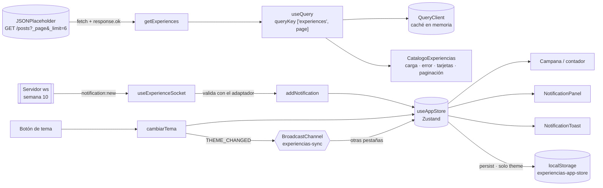

# Semana 11 — TanStack Query y Zustand

Esta semana Wayra Academy separa dos tipos de estado que hasta ahora estaban mezclados:

| Tipo de estado | Herramienta | Qué contiene |
|---|---|---|
| Datos remotos | **TanStack Query** (Desarrollo Web) | Catálogo de experiencias desde la API, con carga, error, caché y paginación |
| Estado global del cliente | **Zustand** (Laboratorio) | Tema, notificaciones y estado de la conexión WebSocket |
| Estado de interfaz local | `useState` | Página elegida, panel abierto, filtros del explorador |

Así queda armado el producto puente que piden las guías: catálogo dinámico, estado global y notificaciones en tiempo real.

## Arquitectura



El recorrido de una notificación es: servidor WebSocket → evento `notification:new` → validación → acción `addNotification` de Zustand → componentes React. Cada componente lee el store con un selector, así que solo se vuelve a dibujar cuando cambia el valor que usa.

---

## Parte A: Desarrollo Web, catálogo con TanStack Query

### Qué se implementó

| Actividad | Archivo | Resultado |
|---|---|---|
| 1. QueryClient | [`src/main.jsx`](../src/main.jsx) | Una sola instancia y un solo `QueryClientProvider` envolviendo `App`. Devtools solo en desarrollo |
| 2. Contrato y API | [`src/features/catalog/api.ts`](../src/features/catalog/api.ts) | `Experience { userId, id, title, body }` y `getExperiences(page)`. Comprueba `response.ok`, valida la forma de la respuesta y lee `X-Total-Count`. Ejemplo guardado en [`respuesta-api-pagina-1.json`](evidencias-semana-11/respuesta-api-pagina-1.json) |
| 3. Hook | [`src/features/catalog/useExperiences.ts`](../src/features/catalog/useExperiences.ts) | `useQuery({ queryKey: ['experiences', page], queryFn })` |
| 4. Vista | [`src/paginas/CatalogoExperiencias.tsx`](../src/paginas/CatalogoExperiencias.tsx), [`TarjetaExperiencia.tsx`](../src/features/catalog/TarjetaExperiencia.tsx) | Ruta `/experiencias` con enlace «Experiencias» en el menú. Las tarjetas reutilizan el estilo `.curso` y las animaciones de Motion de la semana 9. `key={item.id}` |
| 5. Paginación | `CatalogoExperiencias.tsx` | `useState(1)` y botones Anterior y Siguiente. Anterior se desactiva en la página 1 y Siguiente en la 17 |
| 6. Caché y errores | `main.jsx`, `CatalogoExperiencias.tsx` | `staleTime: 60_000`. El error se muestra en lenguaje simple con un botón «Reintentar»; el detalle técnico va a la consola. La caché se demuestra con las Devtools de TanStack Query y la pestaña Network, no en la interfaz |

### Endpoint, queryKey, queryFn y staleTime

- **Endpoint:** `GET https://jsonplaceholder.typicode.com/posts?_page={page}&_limit=6`. La API tiene 100 publicaciones, así que salen 17 páginas (la última con 4). Se puede cambiar la base con `VITE_API_URL`.
- **queryKey `['experiences', page]`:** cada página tiene su propia entrada en la caché.
- **queryFn:** `() => getExperiences(page)`. A propósito no se pasa el `signal` de cancelación a `fetch`. Con él, el doble montaje de `StrictMode` en desarrollo cancelaba la primera petición y la pestaña Network mostraba una petición «fallida» (`net::ERR_ABORTED`) seguida de otra correcta. Sin él, TanStack Query reutiliza la petición en curso: hay una sola petición por página. Si el usuario cambia de página antes de que llegue la respuesta, igual queda guardada en la caché.
- **staleTime de 60 s:** durante un minuto la página se considera fresca. Volver a ella no genera una petición nueva. Pasado ese minuto, se muestra lo que hay en caché y se vuelve a pedir en segundo plano.
- **Otras opciones:** `gcTime` es de 5 minutos (una página sin uso se borra de la memoria después) y `retry` es 1 (un reintento antes de mostrar el error).

### Decisiones

- **Ruta nueva en lugar de reemplazar el explorador.** Los 16 cursos propios de Wayra siguen en `/explorador-cursos`, con sus filtros, búsqueda y favoritos. La API de práctica devuelve textos en latín, así que alimenta una sección aparte, el «Catálogo de experiencias», en lugar de borrar el catálogo real. El tipo `Experience` de la API vive en `features/catalog` y no se mezcla con el `Experience` de los cursos (`src/types/experience.ts`).
- **`getExperiences` devuelve `{ items, page, total, totalPages }`.** Sin el total no hay forma de desactivar Siguiente en la última página.
- **Sin `placeholderData`.** Si se mostrara la página anterior mientras carga la nueva, la lista no correspondería a la página actual. Además, la diferencia entre una página nueva (indicador de carga) y una visitada (aparece al instante) es justamente lo que demuestra la caché.
- **Interfaz de producto, no de laboratorio.** La página no muestra la hora de los datos, si la caché está fresca ni interruptores de prueba: nada de eso le sirve a quien visita el sitio. La caché se demuestra con las Devtools de TanStack Query, que solo aparecen en `npm run dev` y no entran en el build. El error se provoca como indica la guía: con una URL incorrecta (`VITE_API_URL`) o desconectando la red.
- **Errores en lenguaje simple.** El usuario ve «No pudimos cargar las experiencias. Revisa tu conexión a internet e inténtalo de nuevo.» y un botón «Reintentar». El detalle técnico («El servidor respondió con el código HTTP 404», «No hay conexión con el servidor del catálogo») va a la consola, para quien depura.
- **Paginación solo con total conocido.** Si la primera carga falla, no se sabe si existe una página 2, así que la paginación aparece recién con la primera respuesta.
- **Foco con teclado.** Cuando un botón de paginación se desactiva, el foco pasa al otro botón para no perderse.

### Por qué la caché no es una base de datos

La caché de TanStack Query vive en la memoria de la pestaña. Se pierde al recargar o cerrar, cada usuario tiene la suya y no se comparte, y una página sin uso se borra a los 5 minutos. La fuente de verdad sigue siendo la API. La caché solo evita repetir peticiones mientras los datos son recientes.

---

## Parte B: Laboratorio, estado global con Zustand

### Diseño del estado (actividad 1)

| Dato | Dónde se usa | ¿Se persiste? | Decisión |
|---|---|---|---|
| Tema claro u oscuro | Encabezado y `<html>` | Sí | `persist` con `partialize` guarda solo `theme` |
| Notificaciones | Campana, panel y aviso | No | En memoria, máximo 50 y sin repetir el mismo `id`. Se borran con «Limpiar» |
| Conexión WebSocket | Panel | No | Estado, sala, miembros y último error. Es un estado temporal |
| Usuario de demostración | — | — | La app no tiene sesión. Nunca se guardan credenciales |
| Catálogo | `/experiencias` | No va en Zustand | Lo administra TanStack Query |
| Favoritos y sala elegida | Explorador y panel | Sí (`useFavoritos`) / por pestaña (`sessionStorage`) | Son preferencias locales y se mantienen como estaban |

### Qué se implementó

| Actividad | Archivo | Resultado |
|---|---|---|
| 2. Store | [`src/store/appStore.ts`](../src/store/appStore.ts) | `useAppStore` con `theme`, `notifications` y `conexion`, más sus acciones. `persist` usa la clave `experiencias-app-store` y valida lo que lee de localStorage |
| 3. Migración | `CentroNotificaciones`, `NotificationPanel`, `NotificationToast`, `Layout` | Selectores como `useAppStore(s => s.notifications)`. Se eliminaron `NotificationContext.tsx`, `useTema.js` y el Context de la conexión |
| 4. Persistir el tema | `appStore.ts`, `index.html` | Una suscripción aplica la clase `tema-oscuro` en el mismo instante en que cambia el store. `index.html` lee la clave nueva antes del primer cuadro para que no haya destello |
| 5. WebSocket | [`useExperienceSocket.ts`](../src/hooks/useExperienceSocket.ts), [`socketExperiencias.ts`](../src/servicios/socketExperiencias.ts) | Al llegar `notification:new` se llama a `useAppStore.getState().addNotification(...)`. Se usa el mismo contrato de la semana 10, no el ejemplo de Socket.IO de la guía |
| 6. Mostrar | Campana y panel | Contador de no leídas, historial y botón «Limpiar» |
| 7. Pestañas | [`src/servicios/sincronizacionTema.ts`](../src/servicios/sincronizacionTema.ts) | Canal `experiencias-sync` con el mensaje `THEME_CHANGED`. Lo abre `App` y lo cierra al desmontar |

### Decisiones respecto a la guía

- **La guía de ejemplo usa `socket.on(...)` (Socket.IO).** El servidor de la semana 10 usa WebSocket estándar con `ws`, así que el listener es `addEventListener("message")` sobre el evento `notification:new`. El payload se valida con el adaptador antes de llegar al store; no se usa `String(payload.x ?? ...)`.
- **Se conserva el tipo `AppNotification` de la semana 10** (`title`, `message`, `type` y `read`) en lugar del `Notice` reducido de la guía. Así el contrato no cambia.
- **Se migró también el Context de la conexión.** El estado de la conexión pasó al store, y el envío de acciones a un servicio (`socketExperiencias.ts`) que guarda la referencia a la única conexión. Ya no queda ningún `createContext` en `src`.
- **Las acciones del store se leen con `getState()` dentro de los listeners.** El efecto del socket depende solo de la URL, así que ningún render cierra ni vuelve a abrir la conexión.
- **Se reemplazó el evento `storage` de `useTema` por `BroadcastChannel`.** Además se migra la clave antigua: si alguien tenía guardado `wayra-tema`, se respeta la primera vez.
- **Herramientas de prueba solo en desarrollo.** El botón «Generar notificación de prueba» que pidió la guía de la semana 10 (como botón *temporal*), el cambio de sala, el envío de un payload inválido y los datos técnicos de la conexión (sala y miembros) aparecen en el panel bajo «Herramientas de desarrollo» solo con `npm run dev`. Vite reemplaza `import.meta.env.DEV` por `false` al compilar y ese código no llega al sitio publicado. El visitante solo ve sus notificaciones y si están «En vivo».
- **El cambio de tema mantiene la View Transition** (el fundido) de semanas anteriores. La pestaña que recibe el aviso no lo vuelve a enviar, así que no se produce un eco infinito.

### Qué se guarda en localStorage

```json
{"state":{"theme":"dark"},"version":1}
```

Solo el tema. No se guardan tokens, contraseñas, notificaciones ni datos de la conexión. Lo comprueba la prueba «localStorage» de la tabla de abajo.

---

## Pruebas obligatorias (las dos guías)

Se probaron en el navegador real: dos pestañas de Edge controladas con Playwright, el servidor `ws` del equipo y la API real. A las respuestas de la API se les sumó un retraso de 0,9 s para que se viera el estado de carga. Resultado: **22/22 criterios cumplidos** ([`resultados.json`](evidencias-semana-11/resultados.json)). Además, la prueba de dos clientes de la semana 10 y las 12 pruebas del servidor (`npm test`) siguen pasando.

| Guía | Prueba | Resultado medido | Cumple |
|---|---|---|---|
| A | Carga | «Cargando experiencias de la página 1…» con `role="status"` y 6 esqueletos, luego 6 tarjetas | Sí |
| A | API | La página 1 trae los ids 1–6 y la página 2 los ids 7–12 | Sí |
| A | Paginación | Anterior desactivado en la 1. Siguiente desactivado en la 17 (4 tarjetas). El foco no se pierde | Sí |
| A | Caché | Al volver a la 1: 0 peticiones nuevas y sin indicador de carga. En las Devtools, `["experiences",1]` aparece como *Fresh* | Sí |
| A | Interfaz limpia | La página no muestra textos de caché ni secciones de prueba | Sí |
| A | Error | Con 404 o sin red: `role="alert"` con «No pudimos cargar las experiencias…», sin códigos técnicos. «Reintentar» recupera los datos al restaurar el endpoint | Sí |
| A | Responsive | A 375 px no hay desplazamiento horizontal y los botones miden 44 px | Sí |
| A | Un solo provider | 1 `new QueryClient()` y 1 `<QueryClientProvider>`, en `main.jsx` | Sí |
| A | Datos reales | Peticiones a jsonplaceholder, no a un arreglo local | Sí |
| B | Migración | Tema y notificaciones funcionan sin ningún `createContext` ni Provider antiguo | Sí |
| B | Persistencia | claro → oscuro → recargar → sigue oscuro (`aria-pressed="true"`) | Sí |
| B | localStorage | `{"state":{"theme":"dark"},"version":1}`, solo el tema | Sí |
| B | WebSocket | Un evento emitido desde el servidor cambia el contador a «1 sin leer», lo agrega al panel y muestra el aviso | Sí |
| B | Conexión única | Tras navegar por 4 rutas y cambiar el tema 4 veces, la sala sigue con 2 miembros y un evento suma exactamente 1 | Sí |
| B | Sincronización | El cambio de tema en la pestaña A se refleja en la B, y al revés, sin recargar | Sí |
| B | Regresión | Explorador con 16 cursos, favoritos, Motion y vista móvil funcionando. Consola sin errores inesperados | Sí |

Capturas en [`evidencias-semana-11/`](evidencias-semana-11/):

| Archivo | Muestra |
|---|---|
| `01` | Estado de carga |
| `02` | Página 1 cargada |
| `03` | Página 2 |
| `04` | Devtools de TanStack Query: página 1 *Fresh* y página 2 en caché |
| `05` | Error por URL inválida |
| `06` | Error por red caída |
| `07` | Vista móvil |
| `08` | Tema oscuro persistido |
| `09` | Pestaña B sincronizada |
| `10` | Evento WebSocket en el contador y el panel, con Zustand |

### Cómo repetir las pruebas a mano (para el video)

1. Terminal 1: `cd server && npm start`. Terminal 2: `npm run dev`.
2. **Caché:** abre `/experiencias` con la pestaña Network a la vista y filtra por `posts`. Pasa a la página 2 (sale una petición) y vuelve a la 1: aparece al instante y **sin** petición nueva. Abre las Devtools de TanStack Query (el botón abajo a la izquierda): `["experiences",1]` está *Fresh* y pasa a *Stale* al minuto.
3. **Error:** en DevTools → Network elige **Offline** y recarga la página: aparece el aviso con «Reintentar». Vuelve a **No throttling** y pulsa «Reintentar». Otra forma: pon `VITE_API_URL=https://jsonplaceholder.typicode.com/no-existe` en `.env.local`, reinicia `npm run dev` y luego quítala.
4. **Persistencia:** cambia el tema y recarga. En DevTools → Application → Local Storage revisa `experiencias-app-store`.
5. **Pestañas:** abre dos pestañas y cambia el tema en una. La otra cambia sola.
6. **WebSocket:** abre la campana y, en «Herramientas de desarrollo», pulsa «Generar notificación de prueba». Con dos ventanas se ve llegar en las dos.

## Preguntas de reflexión (guía A, sección 10)

1. **¿Qué diferencia hay entre el estado de una consulta remota y el de un botón o una preferencia?**
   - La consulta remota es una copia de datos que pertenecen al servidor. Puede estar cargando, fallar o quedar vieja, y hay que pedirla de nuevo o sincronizarla. TanStack Query gestiona ese ciclo.
   - El estado de un botón (panel abierto, página elegida) o una preferencia (tema) pertenece al navegador. Es siempre exacto y no necesita red. Por eso vive en `useState` o en Zustand.
2. **¿Por qué `page` debe formar parte de la `queryKey`?** La clave identifica a los datos en la caché. Si fuera solo `['experiences']`, todas las páginas compartirían una sola entrada: cambiar de página no volvería a consultar, o la página 2 pisaría a la 1 y no se podría reutilizar ninguna.
3. **¿Qué pasaría si cada componente ejecutara `fetch` por separado?**
   - Habría peticiones repetidas a la misma URL y ninguna caché compartida.
   - Cada componente tendría que llevar su propia lógica de carga y error.
   - Habría riesgo de respuestas que llegan desordenadas, y dos partes de la pantalla podrían mostrar datos distintos.
   - Con TanStack Query, dos componentes con la misma clave comparten una sola petición y un solo resultado.
4. **¿Por qué un error debe comunicarse al usuario?** Sin mensaje, una lista vacía parece que «no hay experiencias» o que la app se colgó. El aviso con `role="alert"` explica qué pasó, también a quien usa lector de pantalla, y ofrece cómo recuperarse («Reintentar»).
5. **¿Qué información debe venir de la API y cuál pertenece al estado global?**
   - De la API viene lo que es del servidor y comparten todos: el catálogo, los totales y las experiencias.
   - Al estado global del cliente pertenece lo que es de este usuario en este navegador: el tema, las notificaciones recibidas en la sesión y el estado de la conexión.
   - El catálogo no se copia en Zustand: tendría dos fuentes de verdad.

## Dificultades y limitaciones

- **Las guías piden ramas distintas.** La de Desarrollo Web pide `feature/week11-tanstack-query` y la de Laboratorio pide `immersive-lab`. Las dos partes se integraron en la rama `semana-11`, creada desde `semana-10-websocket`, porque dependen una de otra: el catálogo y el store conviven en la misma app.
- **La API no persiste.** JSONPlaceholder es de práctica: sus textos están en latín y no guarda cambios. Sirve para demostrar el flujo, no como contenido real.
- **Alcance de `BroadcastChannel`.** Solo sincroniza pestañas del mismo navegador y perfil. Entre equipos distintos, la sincronización sigue siendo responsabilidad del servidor WebSocket.
- **Las notificaciones no se comparten entre pestañas.** Cada pestaña tiene su propio socket y su propia lista en memoria. Ambas reciben los eventos del servidor, pero «Limpiar» en una no limpia la otra.
- **`StrictMode` en desarrollo.** Monta el efecto del socket dos veces. El navegador avisa que el primer socket «se cerró antes de conectar»; en producción no ocurre.
- **Devtools.** Las de TanStack Query aparecen solo con `npm run dev` y no se incluyen en `npm run build`.
