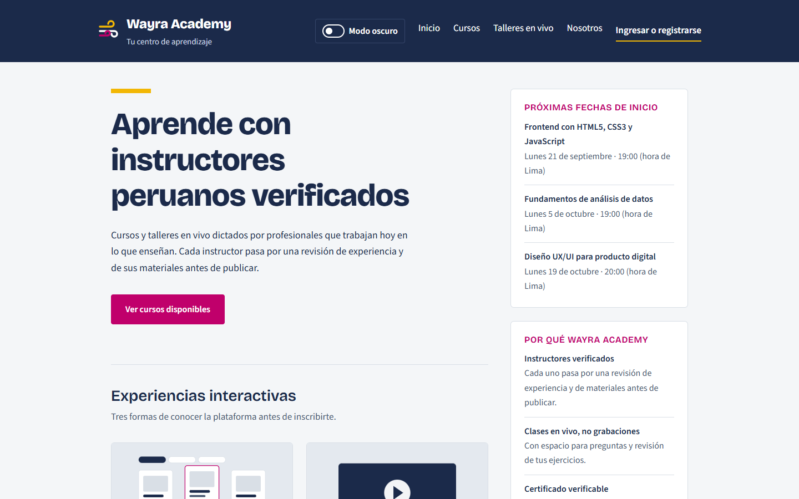
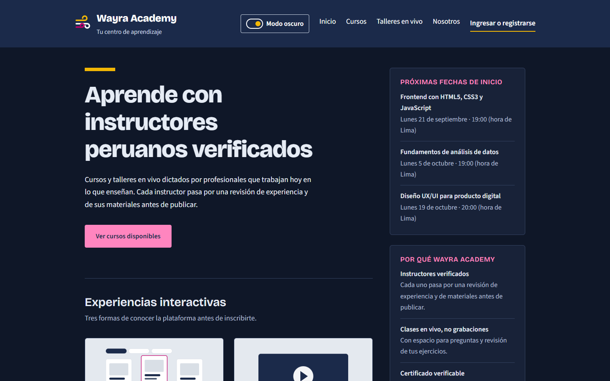
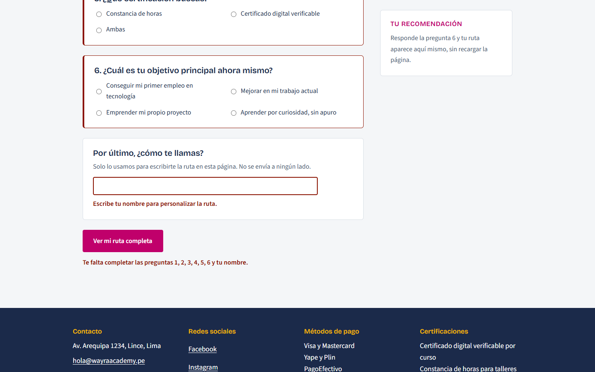
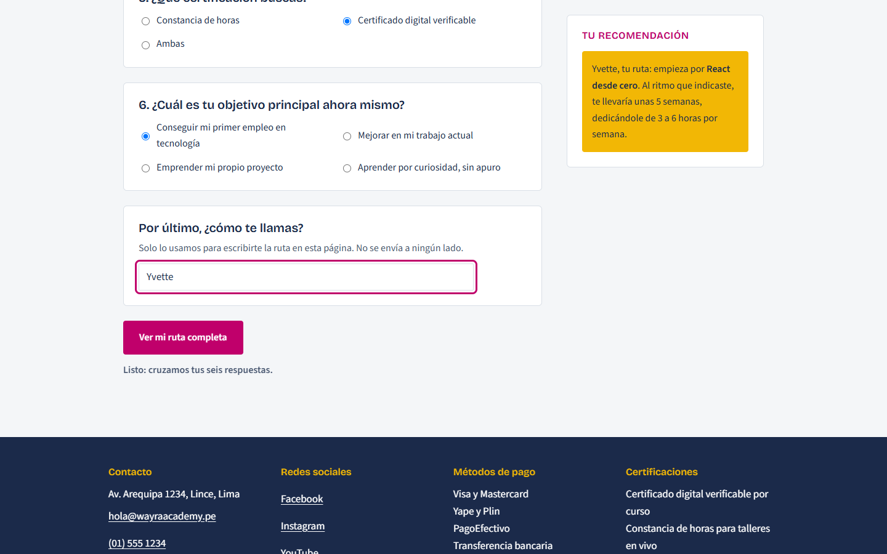
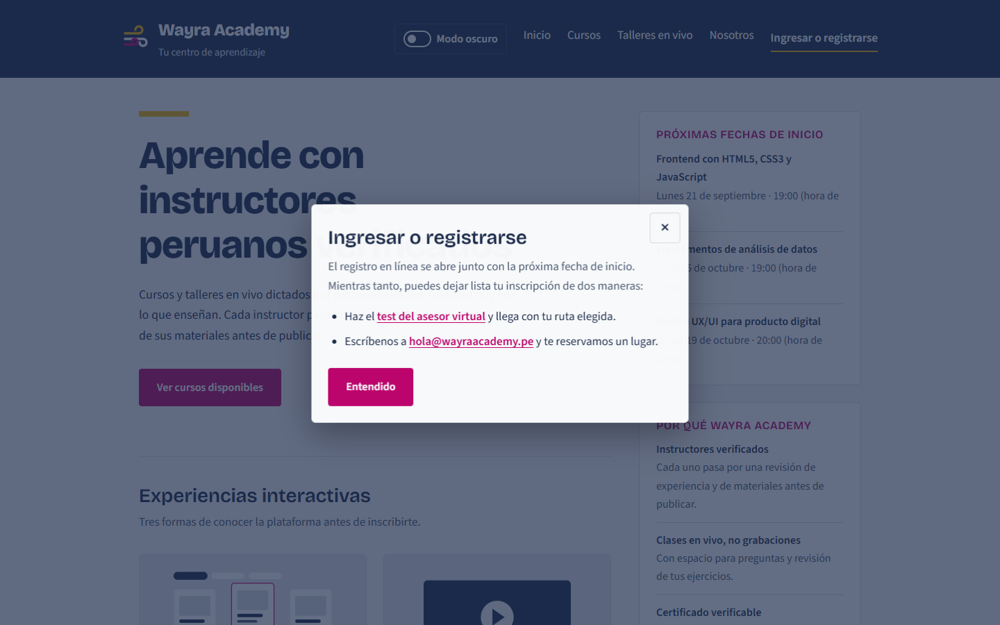
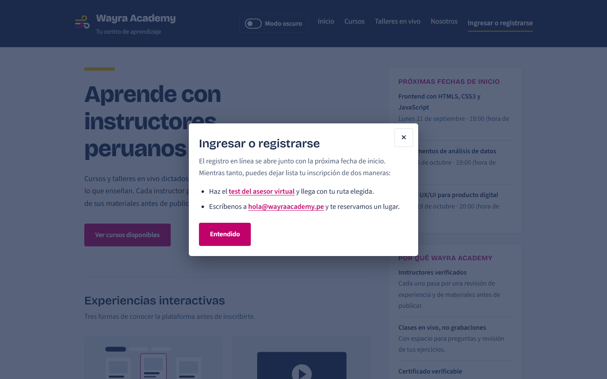
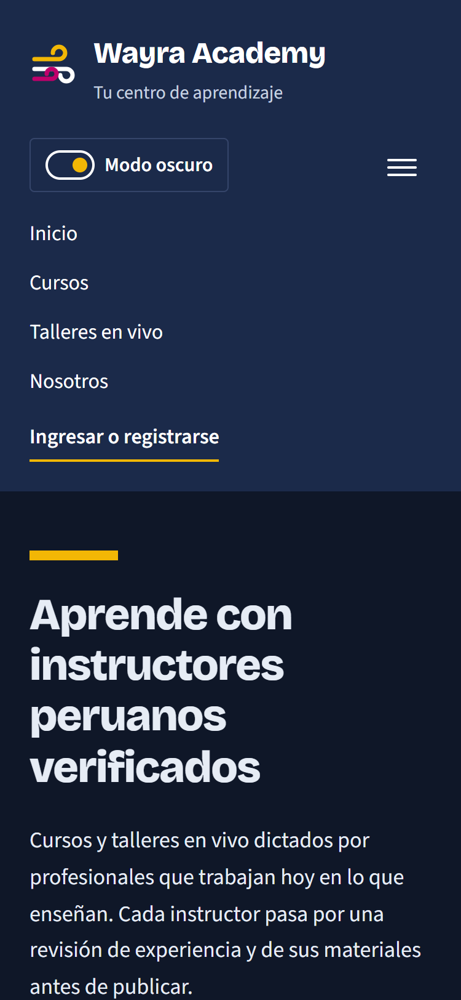
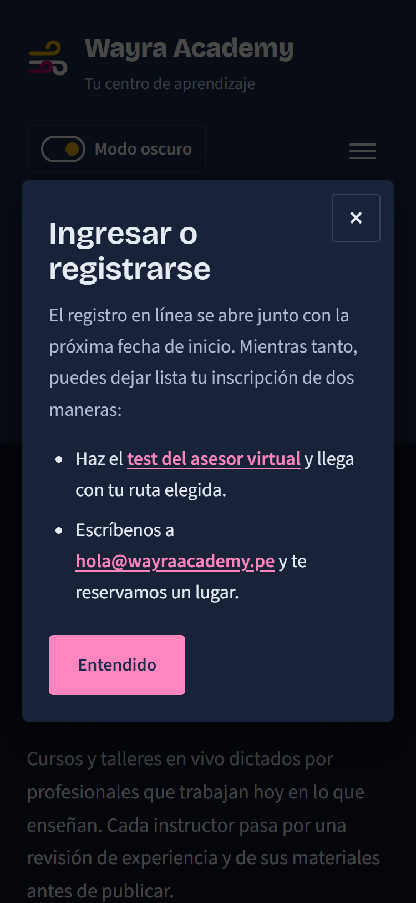
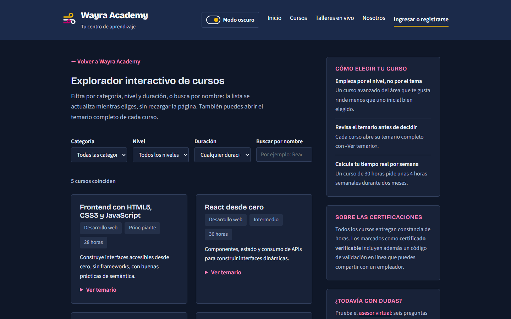
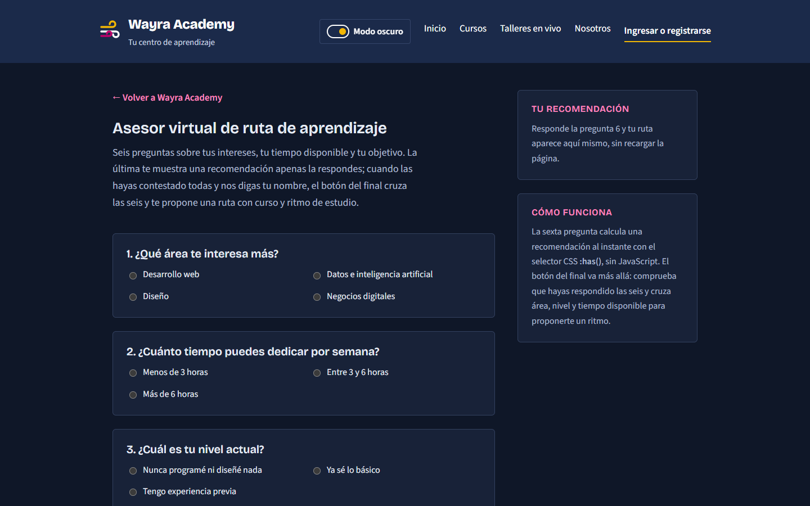

# Wayra Academy — Semana 4: Evaluación de Conocimiento Grupal

**Desarrollo Web Full Stack – FrontEnd** · Modalidad grupal · Producto: solución + video

| | |
|---|---|
| Proyecto | Wayra Academy: el mismo producto de las Semanas 1, 2 y 3 |
| Fecha | 26 de septiembre de 2026 |
| Repositorio | `DesarrolloWebFullStack/` (HTML, CSS y JavaScript sin frameworks) |

**Integrantes**

1. Chauca Machuca, Jhordi Fabian
2. Tesen Tantachuco, José Antonio
3. Patiño Ramos, Jorge Luis
4. Malpartida Sanchez, Yvette
5. Cherca Lopez, Raul

---

## 1. Punto de partida y diagnóstico

Venimos de tres etapas sobre el **mismo** producto:

```
ESTRUCTURA  →  ADAPTABILIDAD  →  INTERACCIÓN  →  INTEGRACIÓN
 Semana 1        Semana 2          Semana 3        Semana 4
```

Al terminar la Semana 3, Wayra Academy tenía 4 páginas semánticas, un layout responsive con Grid y una
primera capa de JavaScript: filtrado del catálogo y validación del asesor. Contrastamos ese estado con
los cinco requerimientos del caso integrador y encontramos estos problemas, ordenados por prioridad:

| # | Problema detectado | Requerimiento | Prioridad | Por qué debía corregirse |
|---|---|---|---|---|
| 1 | No existía modo oscuro. Los colores estaban en tokens, pero nada los cambiaba. | RF1 | Alta | Era una funcionalidad obligatoria que faltaba por completo. |
| 2 | El asesor **no era un formulario**. Validaba a mano con `click` en un `type="button"`: no había `<form>`, `submit`, `required` ni envío con Enter. | RF2 | Alta | Las reglas vivían solo en JavaScript y el navegador no las conocía. Sin JS no había validación. |
| 3 | No existía un modal. «Ingresar o registrarse» era un enlace a `#pie`, un destino sin relación con la acción. | RF3 | Alta | Era una funcionalidad obligatoria que faltaba. Además, el enlace llevaba al usuario a un sitio que no respondía a lo que había pedido. |
| 4 | El anillo de foco era rosa (`#C0006B`) sobre el encabezado azul (`#1B2A4A`): contraste **2.34:1**. | RF4 | Media | WCAG 1.4.11 pide al menos 3:1 en un indicador de foco. Con teclado, el foco casi no se veía en el menú. |
| 5 | `.test__resultado` usaba `--color-tinta` fijo como color de texto. | RF1/RF4 | Media | En tema oscuro habría quedado tinta sobre fondo oscuro: 1.1:1, ilegible. Lo encontramos al diseñar el tema. |
| 6 | El subrayado amarillo de «Ingresar o registrarse» nunca se veía. | RF4 | Baja | `.navegacion a` (especificidad 0,1,1) reescribía en transparente el color que ponía `.navegacion__acceso` (0,1,0). |
| 7 | La consola mostraba un 404 de `/favicon.ico` en cada página. | Pruebas | Baja | El proyecto nunca declaró favicon. Era un error de consola pendiente desde la Semana 1. |

---

## 2. PARTE I — Evaluación teórica

### 1. ¿Qué papel cumple el DOM entre HTML y JavaScript?

El HTML es solo texto. Al cargarlo, el navegador construye con él el **DOM** (*Document Object Model*):
un árbol de objetos en memoria, un nodo por cada elemento, atributo y texto. JavaScript nunca toca
el archivo `.html`: lee y modifica ese árbol. Cada cambio en el árbol se refleja en pantalla al instante
y sin recargar. Por eso el DOM es el **puente**: el HTML lo crea, JavaScript lo manipula y el navegador
lo dibuja.

**Ejemplo del proyecto.** Cuando el formulario del asesor es válido, `interaccion.js` busca el párrafo
de la ruta, le escribe el texto y lo muestra:

```js
const ruta = document.getElementById("ruta-completa");  // 1. seleccionar el nodo
ruta.textContent = nombre.value.trim() + ", tu ruta: empieza por ";
ruta.append(destacado);                                   // 2. agregar un <strong> creado aparte
ruta.hidden = false;                                      // 3. cambiar un atributo: se hace visible
```

El archivo HTML sigue igual (`<p id="ruta-completa" hidden></p>`). Lo que cambió es el nodo en el DOM.

### 2. Diferencia entre `querySelector()` y `querySelectorAll()`

| | `querySelector()` | `querySelectorAll()` |
|---|---|---|
| Devuelve | El **primer** elemento que coincide con el selector | **Todos** los que coinciden, en una `NodeList` |
| Si no hay coincidencias | `null` | Una lista vacía (`length === 0`) |
| Uso típico | Un elemento único, o uno dentro de otro | Recorrer varios elementos con un bucle |

**Cuándo usamos cada uno:**

- `querySelectorAll(".curso")` en el explorador: son **5 tarjetas** con la misma clase y hay que evaluar
  todas en un bucle. `querySelector` solo devolvería la primera.
- `curso.querySelector(".curso__titulo")`: dentro de **cada** tarjeta hay un solo título.
- `modal.querySelectorAll("[data-cerrar-modal]")` en la Semana 4: el modal tiene **dos** botones de
  cierre (la × y «Entendido»), y los dos necesitan el mismo escuchador.
- Cuando el elemento tiene `id` usamos `getElementById`, que es más directo y deja claro que es único.

### 3. Modificar `style` directamente frente a usar `classList`

`elemento.style.color = "red"` escribe un **estilo en línea** en el atributo `style` del elemento. El
color queda escrito dentro del JavaScript y le gana a casi cualquier regla del CSS. Además, para
deshacerlo hay que recordar el valor anterior. `elemento.classList.add("clase")` solo cambia el
**estado** del elemento. Qué aspecto tiene ese estado lo decide el CSS.

**Ventajas de trabajar con clases:**

1. **Separación de responsabilidades.** JavaScript decide *cuándo*; el CSS decide *cómo se ve*.
2. **Un solo lugar para cambiar el diseño.** Se edita la regla, no el código que la aplica.
3. **Se aprovecha todo el CSS:** transiciones, media queries, `:hover` y los tokens de `:root`.
4. **Es reversible con una línea:** `classList.toggle()` pone o quita la clase y devuelve el estado nuevo.

**Ejemplo del proyecto (RF1).** El modo oscuro es **una sola** clase sobre `<html>`:

```js
const oscuro = document.documentElement.classList.toggle("tema-oscuro");
```

Esa clase redefine 13 tokens en `:root.tema-oscuro` y cambian las 4 páginas completas. Hacer lo mismo
con `style` obligaría a recorrer cada tarjeta, botón y texto para cambiarles el color uno por uno.

### 4. Eventos `click`, `input` y `submit`

| Evento | Cuándo se dispara | Interacción real en Wayra Academy |
|---|---|---|
| `click` | Al activar un elemento: con el ratón, con un toque o con **Enter/Espacio** sobre un `<button>` | Alternar el tema con el botón «Modo oscuro» y abrir o cerrar el modal «Ingresar o registrarse» |
| `input` | Cada vez que cambia el valor de un campo: cada tecla, al pegar, al borrar o al marcar un radio | El buscador del explorador filtra letra por letra. En el asesor, el error del nombre se corrige en vivo mientras se escribe. |
| `submit` | Al enviar un `<form>`, con su botón `type="submit"` o con Enter dentro de un campo | Enviar el test del asesor. Lo interceptamos con `preventDefault()` para validar y calcular la ruta **sin salir de la página** |

`submit` se escucha en el `<form>` y no en el `click` del botón, porque así también cubre el envío con
Enter.

### 5. ¿Qué problema resuelve la Constraint Validation API?

Evita reescribir en JavaScript reglas que el HTML ya sabe expresar. Las reglas se declaran en el marcado
(`required`, `minlength`, `pattern`, `type="email"`...) y el navegador expone su estado:

- `campo.validity`: un objeto que dice **qué** regla falla (`valueMissing`, `tooShort`,
  `patternMismatch`, `typeMismatch`...).
- `formulario.checkValidity()`: revisa todas las reglas de una vez y devuelve `true` o `false`.
- La pseudoclase `:invalid` y `setCustomValidity()` para reglas propias.

Así hay una sola fuente de verdad para las reglas, y si JavaScript no carga el navegador las sigue
aplicando.

**Si falta un campo obligatorio:** el formulario **no debe enviarse**. El usuario debe saber *qué*
falta y *dónde*. En nuestro asesor, al enviar con datos faltantes:

1. `preventDefault()` detiene el envío y `checkValidity()` devuelve `false`.
2. Cada pregunta sin responder se marca con borde y franja roja, así que no depende solo del color.
3. Junto al nombre aparece un mensaje concreto: «Escribe tu nombre para personalizar la ruta.». El campo
   recibe `aria-invalid="true"`.
4. Bajo el botón, un aviso con `role="status"` resume lo pendiente: «Te falta completar las preguntas 3,
   5 y tu nombre.».
5. El foco va al **primer** campo pendiente, para corregir sin buscarlo.

### 6. ¿Qué es la Web Animations API?

Es la API de JavaScript para crear y controlar animaciones con el **mismo motor** que usan las
animaciones CSS, pero desde el código. Su método principal es:

```js
const animacion = elemento.animate(fotogramas, opciones);
```

Devuelve un objeto `Animation` que se puede pausar (`pause()`), invertir (`reverse()`), cancelar
(`cancel()`) o esperar (`animacion.finished`, una promesa).

**Animación activada por el usuario (RF3).** Dentro del `click` del botón que abre el modal:

```js
abrir.addEventListener("click", () => {
  modal.showModal();                       // primero se abre: el foco ya está dentro
  if (menosMovimiento.matches) return;     // respeta «reducir movimiento» del sistema
  modal.animate(
    [ { opacity: 0, transform: "translateY(1.5rem) scale(0.96)" },
      { opacity: 1, transform: "translateY(0) scale(1)" } ],
    { duration: 280, easing: "cubic-bezier(0.2, 0.8, 0.2, 1)" }
  );
});
```

Frente a una animación CSS con clase, tiene dos ventajas: no hay que quitar y volver a poner una clase
para repetirla en cada apertura, y la animación queda en un objeto que se puede consultar. Además,
como `showModal()` va antes que `animate()`, la animación **nunca bloquea** la interacción: se puede
pulsar Esc o Tab desde el primer cuadro.

---

## 3. PARTE II — Caso integrador: matriz de análisis

| Requerimiento funcional | Elemento | Evento | Respuesta esperada | Decisión técnica / justificación |
|---|---|---|---|---|
| **RF1 — Selector de tema** | `<button id="cambiar-tema" aria-pressed>` en el encabezado de las 4 páginas; clase `.tema-oscuro` sobre `<html>` | `click` en el botón (también Enter/Espacio); `DOMContentLoaded` para engancharlo; `pageshow` al volver con «Atrás»; `storage` cuando cambia en otra pestaña | Alterna claro/oscuro en toda la página; la perilla se desplaza; `aria-pressed` pasa a `true`/`false`; la elección se recuerda al cambiar de página; en la primera visita se respeta el tema del sistema | `classList.toggle`: JavaScript no toca colores. El tema oscuro redefine 13 **tokens** en `:root.tema-oscuro`, y ningún componente tiene una versión «oscura». `tema.js` se carga en `<head>` sin `defer` para aplicar la clase **antes del primer pintado**, sin destello blanco. `localStorage` va en `try/catch`. Abiertas con doble clic (`file://`), Firefox no comparte `localStorage` entre archivos, así que el tema viaja en `?tema=` de los enlaces internos. Contraste AA verificado en todas las combinaciones. |
| **RF2 — Formulario** | `<form id="form-asesor">` con 19 radios en 6 grupos (`required` en el primero de cada grupo), `<input id="nombre-asesor" required minlength="2" pattern>`, `<p id="nombre-error">`, `<p id="aviso-ruta" role="status">` | `submit` en el `<form>`; `input` delegado en el `<form>` (atiende los 20 campos con un solo escuchador) | **Inválido:** no se envía, se marca cada pregunta pendiente, aparece un mensaje junto al nombre, el aviso resume lo que falta y el foco va al primer campo pendiente. **Válido:** se escribe la ruta personalizada («Yvette, tu ruta: ...») **sin recargar la página**. Los errores desaparecen en vivo al corregir. | Constraint Validation API (`validity`, `checkValidity()`, `:invalid`) en vez de comprobaciones a mano: las reglas están en el HTML. `noValidate` lo pone JavaScript, así que sin JS el navegador valida igual con sus globos nativos. No se muestran errores antes del primer envío. El nombre entra con `textContent`, nunca con `innerHTML`. |
| **RF3 — Modal animado** | `<button id="abrir-acceso">` en la navegación; `<dialog id="modal-acceso" aria-labelledby>` con botón × y «Entendido» (`data-cerrar-modal`) | `click` en el botón que abre; `click` en los botones de cierre y en el velo; `close` del `<dialog>`; Esc (nativo) | Se abre con una entrada animada de 280 ms (fundido + deslizamiento, y fundido del velo). El foco entra al modal. Se cierra con ×, «Entendido», Esc o un clic fuera. El foco vuelve al botón que lo abrió. | `<dialog>` + `showModal()` nativos: capa superior, resto de la página inerte, foco atrapado y Esc sin código extra. Web Animations API **después** de `showModal()`, así que la animación no bloquea. `prefers-reduced-motion` desactiva la animación, porque la media query del CSS no frena `element.animate()`. El relleno está en `.modal__caja`, así que un clic cuyo destino es el `<dialog>` solo puede venir del velo. |
| **RF4 — Accesibilidad** | Todos los controles nuevos; `.encabezado` y `.pie` (anillo de foco); `aria-*` en el campo y el modal | `Tab`, `Shift+Tab`, `Enter`, `Espacio`, `Esc` | Cada control tiene un nombre comprensible («Modo oscuro», «Ingresar o registrarse», «Cerrar ventana»). El foco es visible y sigue el orden visual. La estructura semántica se conserva: un `<h1>`, landmarks y `<main>`/`<aside>`. | `<button>` y no `<a>`, porque la acción se queda en la página. `aria-pressed` en el tema. `aria-describedby` + `aria-invalid` en el nombre. `role="status"` en el aviso. Anillo de foco amarillo sobre fondo oscuro: de 2.34:1 a **7.82:1**. Los controles que dependen de JS llevan `.solo-con-js`, y `tema.js` marca `<html>` con `.con-js` antes del primer pintado: sin JavaScript no aparece ningún botón inútil, y con JavaScript aparecen desde el primer cuadro, sin que la página salte. |
| **RF5 — Responsive** | `.encabezado__interior` (botón de tema + menú), `.modal`, `.test__campo` | Cambio de ancho de la ventana (media queries `40em` y `62em`) | Ni el botón de tema, ni el modal, ni el campo nuevo rompen el layout. 0 desbordes horizontales en móvil, tablet y escritorio, en los dos temas. | En móvil, el botón de tema **comparte fila** con el menú hamburguesa (Grid con dos elementos en la misma celda), así el encabezado no crece. Desde `40em` vuelve a ser una fila con Flexbox. El modal mide `min(34rem, 100% - 2rem)`. Solo unidades relativas y tokens. Verificado en 24 combinaciones. |

---

## 4. PARTE III — Implementación práctica

Archivos tocados:

| Archivo | Cambio |
|---|---|
| `js/tema.js` | **Nuevo** (151 líneas). Selector de tema, global en las 4 páginas. |
| `js/interaccion.js` | El bloque B pasa a ser un formulario validado y se agrega el bloque C (modal). 388 líneas. |
| `css/estilos.css` | Tokens del tema oscuro, componentes `.tema` y `.modal`, campo del formulario y foco en fondo oscuro. 60 tokens. |
| `index.html`, `explorador-cursos.html`, `clase-muestra.html`, `asesor-virtual.html` | Botón de tema, botón de acceso, `<dialog>`, favicon y scripts. Formulario en el asesor. |

### Actividad A — Selector de tema

- **Control visible:** botón «Modo oscuro» con un interruptor dibujado. El estado se ve por la
  **posición** de la perilla, no solo por su color.
- **`classList`:** `document.documentElement.classList.toggle("tema-oscuro")`.
- **HTML semántico conservado:** es un `<button type="button">` con `aria-pressed` dentro del `<header>`.
  No se agregó ningún `<div>` clicable.
- **Cambio visible y comprensible:** cambian el fondo, las tarjetas, los textos y los botones de las 4 páginas.
- **Global en todo el sitio:** la elección se mantiene al pasar de una página a otra, con servidor o abriendo los archivos con doble clic, al volver con «Atrás» y entre pestañas.

```css
:root.tema-oscuro {
  color-scheme: dark;              /* radios y barras de desplazamiento nativos también en oscuro */
  --color-papel:       #0F1728;
  --color-superficie:  #182238;
  --color-texto:       #E6ECF5;
  --color-accion:      #FF85BF;    /* rosa aclarado: 7.06:1 sobre superficie */
  --color-sobre-accion: var(--color-tinta);  /* texto de botón: 6.34:1 */
  /* ... 13 tokens en total */
}
```





### Actividad B — Formulario

- **Selección con JavaScript:** `getElementById("form-asesor")`, `getElementById("nombre-asesor")` y
  `querySelectorAll(".test__pregunta, .test__final")` para los 6 grupos.
- **Eventos `input` y `submit`:** los dos se escuchan en el `<form>`.
- **Impedir el envío:** `evento.preventDefault()` + `formulario.checkValidity()`.
- **Retroalimentación clara:** borde y franja en cada pregunta pendiente, mensaje junto al nombre, aviso
  resumen y foco en el primer error.

```js
formulario.addEventListener("submit", (evento) => {
  evento.preventDefault();          // la ruta se calcula aquí: la página no se recarga
  intentoEnvio = true;
  const { respuestas, faltan } = revisarPreguntas();
  const nombreValido = revisarNombre();

  if (!formulario.checkValidity()) {
    escribirAviso(faltan, nombreValido);
    formulario.querySelector(":invalid").focus();
    return;
  }
  escribirRuta(respuestas);
});
```

**Caso inválido** (enviar vacío):



**Caso válido** (6 respuestas + nombre «Yvette»):



### Actividad C — Modal animado

- **Botón que lo activa:** reutilizamos «Ingresar o registrarse» de la navegación, que pasó de
  `<a href="#pie">` a `<button>`.
- **Mostrar y ocultar con JavaScript:** `modal.showModal()` y `modal.close()`.
- **Web Animations API en la entrada:** `modal.animate()` sobre el panel y sobre `::backdrop`.
- **No impide la interacción:** la prueba P12 cierra el modal con Esc a 2 ms de abrirlo, en plena
  animación.





### Actividad D — Pruebas y depuración

- **Mobile y desktop:** 375, 768 y 1440 px, en los dos temas.
- **Consola:** revisada en todas las pruebas. Se corrigió el 404 del favicon.
- **Teclado:** Tab, Enter, Espacio y Esc sobre todos los controles nuevos.
- **Registro:** 21 pruebas, en la tabla de la sección 5.






---

## 5. Tabla de pruebas

Las pruebas se ejecutaron en **Microsoft Edge (Chromium)**, automatizadas con Playwright, sobre un
servidor local. Así cada resultado observado es una medición y no una apreciación.

| Prueba | Condición inicial | Resultado esperado | Resultado observado |
|---|---|---|---|
| P1. Tema: clic en «Modo oscuro» | `index.html` a 1440 px, sistema en claro, sin preferencia guardada | Se agrega `.tema-oscuro`, el fondo cambia y `aria-pressed` pasa a `true` | ✅ Fondo de `rgb(244,246,248)` a `rgb(15,23,40)`, clase presente, `aria-pressed="true"` |
| P2. Tema: cambiar de página | Modo oscuro elegido en P1 | La elección se recuerda y la otra página abre en oscuro | ✅ `explorador-cursos.html` abre en oscuro, `aria-pressed="true"` |
| P3. Tema con teclado | Foco en el botón, tema oscuro activo | Espacio vuelve a claro y Enter a oscuro | ✅ Espacio → claro, Enter → oscuro |
| P4. Tema del sistema | Primera visita, sistema operativo en modo oscuro | Sin elección guardada, abre en oscuro | ✅ Abre con `.tema-oscuro` y `aria-pressed="true"` |
| P5. Formulario: enviar vacío | `asesor-virtual.html` sin nada respondido | No se envía; aviso con lo que falta; 6 grupos marcados; foco en la pregunta 1 | ✅ «Te falta completar las preguntas 1, 2, 3, 4, 5, 6 y tu nombre.» · 6 grupos marcados · foco en `p1` · URL sin cambio |
| P6. Nombre «J» y luego «123» | Primer intento de envío ya hecho | Mensaje distinto para `tooShort` y `patternMismatch`, en vivo | ✅ «El nombre debe tener al menos 2 letras.» / «Empieza con una letra y usa solo letras, espacios, apóstrofo o guion.» |
| P7. Corregir el nombre | Nombre «123» con error visible | El error desaparece sin volver a pulsar el botón | ✅ Mensaje vacío, `aria-invalid="false"`, el aviso ya no menciona el nombre |
| P8. Caso válido con Enter | Nombre válido; se responden las 6 preguntas | Se valida sin salir de la página y se escribe la ruta | ✅ Aviso en vivo: «Todo completo...». Tras Enter: «Yvette, tu ruta: empieza por React desde cero...» · URL sin cambio |
| P9. Abrir el modal | `index.html`, modal cerrado | Se abre, la entrada se anima y el foco entra | ✅ `open=true` · 2 animaciones en curso (panel y velo) · foco en «Cerrar ventana» |
| P10. Cerrar con Esc | Modal abierto | Se cierra y el foco vuelve al botón | ✅ `open=false` · foco en `#abrir-acceso` |
| P11. Clic dentro, en el velo y en «Entendido» | Modal abierto | Clic dentro no cierra; velo y «Entendido» sí | ✅ Dentro: sigue abierto · velo: cerrado · «Entendido»: cerrado |
| P12. Esc en plena animación | Modal recién abierto | La animación no bloquea el cierre | ✅ Esc a 2 ms de abrir → cerrado |
| P13. «Reducir movimiento» | Sistema con `prefers-reduced-motion: reduce` | El modal abre sin animación | ✅ `open=true` · 0 animaciones |
| P14. Móvil 375 px | Tema oscuro, menú hamburguesa abierto | El botón de tema comparte fila con el menú; el modal cabe en pantalla | ✅ Modal de x=20 a x=355 en 375 px |
| P15. Responsive | 4 páginas × 3 anchos (375, 768, 1440) × 2 temas | 0 desbordes horizontales | ✅ 24 de 24 combinaciones sin desborde |
| P16. Orden de Tab | `index.html` recién cargado | Salto → Modo oscuro → menú → Ingresar, en orden visual | ✅ Saltar al contenido → Modo oscuro → Inicio → Cursos → Talleres → Nosotros → Ingresar o registrarse |
| P17. Sin JavaScript | JavaScript desactivado | No aparecen botones que no funcionarían; el formulario sigue validando | ✅ Tema y acceso ocultos · al enviar vacío la validación nativa impide el envío |
| P18. Regresión Semana 3 | `explorador-cursos.html`, filtros por defecto | Categoría = Desarrollo web → «2 cursos coinciden» | ✅ «2 cursos coinciden» |
| P19. Tema entre páginas abiertas con doble clic (`file://`) | `index.html` abierto como archivo local, tema claro | Tras elegir oscuro, la página siguiente abre en oscuro (y al revés); los enlaces `#ancla` no cambian | ✅ Enlace reescrito a `explorador-cursos.html?tema=oscuro` · explorador abre en oscuro · tras volver a claro y regresar, `index.html?tema=claro` abre en claro · anclas intactas. Verificado también en **Firefox** real |
| P20. Dos pestañas abiertas | `index.html` y `clase-muestra.html` en pestañas distintas | Al cambiar el tema en una, la otra se actualiza sola | ✅ La otra pestaña pasa a oscuro con `aria-pressed="true"` · con servidor la URL queda limpia (`index.html`) |
| P21. Consola | Registro de P1 a P20 | 0 errores, 0 advertencias, 0 respuestas 4xx/5xx | ✅ 0 mensajes. Antes de la corrección: 404 de `/favicon.ico` en cada página |

**Resultado: 21 de 21 pruebas superadas.**

### Verificación final en varios navegadores y herramientas

| Verificación | Herramienta | Resultado |
|---|---|---|
| Pruebas P1–P21 | Microsoft Edge 154 (Playwright) | ✅ 21 de 21 |
| Pruebas P1–P21 | Google Chrome 153 (Playwright) | ✅ 21 de 21 |
| Pruebas F1–F13: tema con servidor y con doble clic, «Atrás», dos pestañas, formulario (tildes, apóstrofo, guion, intento de inyectar HTML), modal y filtros | **Mozilla Firefox 156** (Puppeteer) | ✅ 13 de 13, 0 errores en consola. Datos en `evidencias-semana-4/resultados-firefox.json` |
| Accesibilidad WCAG 2.2 AA en 15 estados (4 páginas × 2 temas, modal abierto, formulario con errores y completo, lista vacía, menú móvil) | axe-core | ✅ **0 violaciones**. Revisado a mano: contraste del modal (6.08:1 a 14.22:1) y subtítulos del video (pendiente desde la Semana 1) |
| Validación HTML de las 4 páginas | W3C Nu Html Checker | ✅ 0 errores |
| Estabilidad visual al cargar (CLS) en 4 páginas × 10 anchos × 2 temas | `PerformanceObserver` de `layout-shift` | ✅ Máximo 0.02 (bueno < 0.1) |
| CSS moderno usado (`:has()`, `color-scheme`, `aspect-ratio`, `text-wrap`, `min()`, `<dialog>`, `pattern` con `\p{L}`) | `CSS.supports()` en Firefox | ✅ Todo soportado |

### Errores encontrados y corregidos durante la depuración

| Error | Causa | Corrección |
|---|---|---|
| 404 de `/favicon.ico` en la consola de las 4 páginas | El proyecto no declaraba favicon y el navegador lo pide por defecto | `<link rel="icon" href="img/logo-wayra.svg">` en las 4 páginas |
| El botón de tema no se ocultaba con `hidden` | `.tema { display: inline-flex }` le gana a la regla del navegador para `[hidden]`, que tiene la menor especificidad | Regla base `[hidden] { display: none !important; }` |
| La ruta parcial (`.test__resultado`) quedaba ilegible en oscuro | Usaba `--color-tinta` fijo en vez de `--color-texto` | Pasa a `--color-texto`, que el tema redefine |
| **El tema no se mantenía al cambiar de página** abriendo los archivos con doble clic en Firefox | Firefox da a **cada archivo** `file://` su propio `localStorage`: lo que guardaba `index.html` no lo veía `explorador-cursos.html`. Comprobado con dos páginas de prueba: la segunda leía `null`. En Edge, o con un servidor, sí se compartía, y por eso P2 pasaba | En `file://` el tema viaja también en la URL de los enlaces internos (`?tema=oscuro`), con `URL` y `history.replaceState`. Además, `pageshow` resincroniza la página al volver con «Atrás» (bfcache) y `storage` avisa a las otras pestañas. Pruebas P19 y P20 |
| **La página saltaba al cargar** entre 640 y 992 px (CLS de hasta **0.53**; Google considera «malo» más de 0.25) | El botón de tema y el de acceso nacían con `hidden` y JavaScript los mostraba después. Al aparecer, el menú pasaba a una segunda fila y todo el contenido bajaba unos 60 px. Las pruebas funcionales no lo veían: lo detectamos midiendo `layout-shift` en 12 anchos | Clase `.solo-con-js` en esos controles. `tema.js`, que corre en `<head>` antes de pintar, pone `.con-js` en `<html>`, y el CSS solo los oculta sin esa clase. CLS máximo ahora: **0.02** (4 páginas × 10 anchos × 2 temas) |
| Seleccionar texto del modal y soltar el ratón fuera lo cerraba | Al soltar sobre el velo, el navegador emite un `click` cuyo destino es el `<dialog>`, igual que un clic real en el velo | Se exige que el botón se haya presionado **y** soltado sobre el velo (`pointerdown` + `click`). Prueba F11 en Firefox |
| Al volver con «Atrás», una página restaurada podía recuperar el tema viejo | `pageshow` daba prioridad al `?tema=` de la URL restaurada, que es el de cuando se dejó la página | Al cargar manda la URL; al volver o al cambiar en otra pestaña manda lo guardado, que es la elección más reciente. Prueba F2 en Firefox |
| En el primer borrador, `index.html` y `clase-muestra.html` no cargaban `interaccion.js` | Esas dos páginas nunca tuvieron JavaScript, y el modal lo necesita en las 4 | Se agregó `<script src="js/interaccion.js" defer>` |

---

## 6. Evidencias obligatorias

| Evidencia | Dónde está |
|---|---|
| Código fuente actualizado | `js/tema.js`, `js/interaccion.js`, `css/estilos.css` y las 4 páginas HTML |
| Capturas de las funcionalidades | `docs/evidencias-semana-4/`: 14 capturas (claro/oscuro, formulario inválido/válido, modal, móvil) |
| Matriz de análisis completada | Sección 3 de este documento |
| Tabla de pruebas completada | Sección 5, con los datos crudos en `docs/evidencias-semana-4/resultados.json` |
| Video grupal de 6 a 8 minutos | Guion en la sección 7. **Pendiente de grabación por el equipo** |

Capturas adicionales del tema oscuro en las otras páginas:





---

## 7. Guion del video de exposición (≈ 7 min 15 s)

> **Recordatorio:** cada integrante debe aparecer **con su imagen y su nombre visibles en pantalla**
> durante su intervención. Recomendación: cámara en una esquina y un rótulo inferior con nombre y
> apellidos. El reparto es una **propuesta**: ajústenlo para que refleje lo que hizo cada uno.

| Tiempo | Bloque de la rúbrica | Integrante | Qué dice / qué muestra |
|---|---|---|---|
| 0:00 – 0:45 | Presentación | **Chauca Machuca, Jhordi Fabian** | Presenta a los 5 integrantes por nombre. Objetivo: convertir Wayra Academy, el mismo producto de las Semanas 1–3, en una interfaz interactiva con tema, formulario validado y modal animado, sin romper lo que ya funcionaba. |
| 0:45 – 1:45 | Problema detectado | **Tesen Tantachuco, José Antonio** | Muestra la tabla de diagnóstico (sección 1). Faltaban RF1 y RF3. El asesor no era un `<form>`. El foco rosa sobre azul daba 2.34:1. Había un 404 en la consola. Explica por qué cada uno debía corregirse. |
| 1:45 – 2:35 | Decisiones: RF1 | **Patiño Ramos, Jorge Luis** | En VS Code: `:root.tema-oscuro` redefine 13 tokens y ningún componente cambia. `classList.toggle`. Por qué `tema.js` va en `<head>` sin `defer`: evita el destello blanco. `aria-pressed`. Por qué, con doble clic en Firefox, el tema viaja en la URL (`?tema=`). |
| 2:35 – 3:25 | Decisiones: RF2 | **Malpartida Sanchez, Yvette** | Los `required`, `minlength` y `pattern` del HTML. `validity.valueMissing` / `tooShort` / `patternMismatch`. `submit` + `preventDefault()`. `input` con delegación. Por qué no se muestran errores antes del primer envío. |
| 3:25 – 4:15 | Decisiones: RF3 y RF4 | **Cherca Lopez, Raul** | `<dialog>` + `showModal()`: foco atrapado y Esc nativos. `element.animate()` **después** de abrir, para que no bloquee. `prefers-reduced-motion`. `<button>` en vez de `<a>`. El foco amarillo sube a 7.82:1. |
| 4:15 – 5:15 | Demostración 1 | **Chauca Machuca, Jhordi Fabian** | En vivo: alterna el tema, cambia de página y el tema se mantiene. DevTools en modo móvil a 375 px: el botón de tema comparte fila con el menú. Abre el menú. |
| 5:15 – 6:15 | Demostración 2 | **Tesen Tantachuco, José Antonio** | Envía el asesor vacío (caso inválido) y corrige en vivo. Lo completa y pulsa Enter (caso válido). Abre el modal y lo cierra con Esc, con la × y con clic fuera, **solo con teclado**. Consola en 0 errores. |
| 6:15 – 7:15 | Cierre | **Los cinco, ~12 s cada uno** | Cada uno dice su aporte y **una** decisión técnica importante (ver tabla siguiente). |

**Aporte y decisión técnica para el cierre (propuesta):**

| Integrante | Aporte | Decisión técnica que defiende |
|---|---|---|
| Chauca Machuca, Jhordi Fabian | Integración de las 4 páginas y pruebas responsive | Botón de tema y menú en la misma fila en móvil, para no alargar el encabezado |
| Tesen Tantachuco, José Antonio | Diagnóstico, matriz de análisis y depuración de consola | Declarar el favicon para dejar la consola en 0 errores |
| Patiño Ramos, Jorge Luis | RF1 — Selector de tema | Redefinir tokens en vez de escribir reglas «oscuras» por componente |
| Malpartida Sanchez, Yvette | RF2 — Formulario validado | Usar la Constraint Validation API: las reglas viven en el HTML y funcionan sin JS |
| Cherca Lopez, Raul | RF3 — Modal y RF4 — Accesibilidad | Abrir con `showModal()` antes de animar, para que la animación no bloquee |

---

## 8. Checklist de entrega

- [x] Respondimos las preguntas teóricas.
- [x] Completamos la matriz de requerimientos.
- [x] Evolucionamos el proyecto de Semanas 1–3.
- [x] Selector de tema funcionando.
- [x] Formulario validado.
- [x] Modal animado.
- [x] Pruebas mobile y desktop.
- [x] Consola revisada y errores corregidos.
- [x] Código fuente y capturas.
- [ ] Video de 6–8 minutos. *(guion listo; falta grabar)*
- [ ] Todos aparecen con imagen y nombre. *(al grabar)*
- [ ] Todos explican su participación. *(al grabar)*
