# Wayra Academy — Semana 4, Planeación B: Laboratorio de Experiencias Web Inmersivas

**Desarrollo Web Full Stack – FrontEnd** · Evaluación de conocimiento grupal · 20 puntos · 3 horas

| | |
|---|---|
| Proyecto | Wayra Academy: el mismo producto de las Semanas 1, 2 y 3 (y de la Planeación A) |
| Fecha | 26 de septiembre de 2026 |
| Repositorio | `DesarrolloWebFullStack/` (HTML, CSS y JavaScript nativos, sin frameworks) |
| Producto | Carrusel «Cursos destacados» en `index.html` + corrección responsive con Container Queries |

**Integrantes y roles operativos**

| Integrante | Rol |
|---|---|
| Chauca Machuca, Jhordi Fabian | Coordinación |
| Tesen Tantachuco, José Antonio | JavaScript / interacción |
| Patiño Ramos, Jorge Luis | CSS / responsive |
| Malpartida Sanchez, Yvette | HTML / semántica |
| Cherca Lopez, Raul | QA / documentación / video |

> Los roles organizan el trabajo, pero no reparten la nota: todos revisamos la solución completa. El
> reparto es una **propuesta**. Ajústenlo para que refleje lo que hizo cada uno.

---

## 1. Relación con la Planeación A

La **Planeación A** (`SEMANA-4-INTEGRACION.md`) cubrió la interactividad básica: DOM, eventos,
`classList`, formulario validado, modal animado y tema oscuro. Esta **Planeación B** no repite eso.
Mueve el reto a la **integración**: diagnosticar antes de programar, corregir el layout con
Grid/Flexbox/**Container Queries** y agregar un **carrusel Anterior/Siguiente** con estado controlado.

Seguimos las reglas de la evaluación:

- Todo se hizo **sobre el mismo proyecto**. El carrusel es una nueva sección de `index.html`, no una
  página aparte.
- La **matriz de diagnóstico** (sección 3) se llenó **antes** de escribir el código definitivo.
- Cada cambio responde a un síntoma de la matriz (A–E) y tiene su justificación.

**Cómo obtuvimos el «antes».** Primero integramos un **borrador rápido** del carrusel, como haría
cualquier equipo con prisa: una diapositiva visible con `display`, un contador que suma 1 y un
`min-width` pensado para escritorio. Ese borrador reprodujo **los cinco síntomas del caso** (A–E), y los
medimos y capturamos (sección 4.3). Después lo corregimos. El borrador no quedó en el proyecto: solo
quedan sus capturas y mediciones (`evidencias-plan-b/antes.json`).

---

## 2. PARTE I — Evaluación teórico-práctica

### 1. Scroll horizontal en mobile: ¿qué revisar primero en HTML, luego en CSS y al final en JavaScript?

Vamos **de la capa que todo lo sostiene a la que cambia en tiempo de ejecución**. Además, cada paso es
más barato de verificar que el siguiente.

1. **HTML primero.** Si falta `<meta name="viewport" content="width=device-width">`, el móvil dibuja la
   página a 980 px y ningún CSS lo arregla. Después revisamos el contenido que trae su propio ancho:
   imágenes con `width="800"`, tablas, `<pre>`, URL largas sin cortes o `<iframe>`. En Wayra las
   imágenes llevan `width`/`height` (para reservar espacio y evitar saltos), así que dependen de la
   regla `img { max-width: 100% }`.
2. **CSS después.** Es la causa más común. Buscamos anchos fijos o mínimos (`width`, `min-width`),
   `100vw` (incluye la barra de desplazamiento), márgenes negativos, elementos de Flex o Grid sin
   `min-width: 0` y contenidos que se mueven con `transform` sin un contenedor que los recorte.
   **En nuestro caso fue aquí:** el borrador del carrusel tenía `.diapositiva { min-width: 36rem }` y el
   documento medía **600 px en una pantalla de 375 px**.
3. **JavaScript al final.** Solo si el scroll aparece **después** de interactuar: estilos en línea que
   escribe el script, nodos que crea o una pista que desplaza con `translateX`. Para saberlo, cargamos la
   página, medimos, interactuamos y volvemos a medir.

**Herramienta.** En DevTools, modo móvil, ejecutamos en la consola este script para encontrar al
culpable en vez de adivinarlo:

```js
[...document.querySelectorAll("body *")]
  .filter(e => e.getBoundingClientRect().right > document.documentElement.clientWidth)
```

### 2. En una galería de tarjetas: ¿qué hace Grid, qué hace Flexbox y qué hacen las Container Queries?

| Herramienta | Responsabilidad | Ejemplo concreto en Wayra |
|---|---|---|
| **CSS Grid** | Distribución **bidimensional**: columnas y filas a la vez, y áreas con nombre | `.experiencias__grilla` reparte las 3 tarjetas en 1, 2 o 3 columnas. La barra `.carrusel__controles` usa `grid-template-areas`: en caja estrecha pone el contador arriba y los botones abajo, y en caja ancha, «anterior · contador · siguiente». |
| **Flexbox** | Distribución **en un solo eje**, repartiendo el espacio sobrante | `.carrusel__pista` pone las 5 diapositivas en fila, cada una con `flex: 0 0 100%`. `.tarjeta__cuerpo` es una columna flex donde el texto crece (`flex-grow: 1`), así los botones de las 3 tarjetas quedan alineados abajo. |
| **Container Queries** | El componente decide su forma según el ancho **de su contenedor**, no el de la pantalla | `.carrusel` es un contenedor (`container: carrusel / inline-size`). A partir de `38rem` de **carrusel**, la diapositiva pone la imagen y el texto lado a lado. A 1000 px de ventana, `<main>` mide 592 px, así que se queda apilada. Una media query ahí se equivocaba (síntoma D). |

Regla práctica que aplicamos: **Grid para el esqueleto, Flexbox para alinear dentro de una pieza y
Container Queries para que la pieza se adapte al hueco donde la pongan.**

### 3. Seis elementos `.card` y solo uno activo

```js
const tarjetas = document.querySelectorAll(".card");   // NodeList con las 6

function activar(indice) {
  // Un solo recorrido: la clase queda en la elegida y se quita de las otras 5.
  tarjetas.forEach((tarjeta, i) => {
    tarjeta.classList.toggle("card--activa", i === indice);
  });
}

tarjetas.forEach((tarjeta, i) => {
  tarjeta.addEventListener("click", () => activar(i));
});
```

`classList.toggle(clase, condición)` con segundo argumento **fuerza** el estado: `true` agrega la clase y
`false` la quita. Así no hace falta recordar cuál estaba activa antes: el bucle deja **exactamente una**.
En el carrusel usamos el mismo patrón con las 5 diapositivas (`diapositiva--activa`) y con los 5 puntos
(`aria-current`).

### 4. Carrusel de cinco imágenes: ¿qué estado mínimo necesita JavaScript?

**Un solo número:** el índice activo (`let actual = 0`, de 0 a 4). El total sale de
`diapositivas.length`, no se guarda aparte. Todo lo demás **se deriva** de `actual` en una única función
`pintar()`: la diapositiva visible, el punto marcado, el texto «Curso 2 de 5», el valor de la pista y qué
botón está apagado. Si guardáramos el texto o la clase por separado, podrían desincronizarse (síntoma E).

**En la primera y la última posición** decidimos **no dar la vuelta** (sin *wrap*):

- En la **primera** (0), «Anterior» queda con `aria-disabled="true"`. Si igual se pulsa, el índice se
  **acota**: `Math.max(0, actual - 1)` sigue siendo 0. Nunca existe la posición −1.
- En la **última** (4), «Siguiente» se apaga igual y `Math.min(total - 1, actual + 1)` se queda en 4.
- Usamos `aria-disabled` y **no** `disabled`: un botón `disabled` pierde el foco, y quien llega a la
  última con el teclado quedaría con el foco en ninguna parte.

### 5. ¿Por qué «sin errores en consola» no significa «bien implementado»?

La consola solo muestra **excepciones** y fallos de red. No sabe qué debía pasar. Un código puede ser
válido y hacer otra cosa: sumar el índice pero marcar siempre la primera tarjeta, mostrar «Curso 3 de 5»
con la 1 en pantalla o dejar un scroll horizontal por CSS. **Nuestro borrador tenía los síntomas B, D y
E con la consola en 0 errores.** Solo el síntoma C lanzó un `TypeError`. Por eso las pruebas comparan lo
**esperado** con lo **observado**.

| Tipo | Prueba | Esperado |
|---|---|---|
| Funcional 1 | Desde el curso 1, pulsar «Siguiente» una vez | Contador «Curso 2 de 5», se ve el curso 2, el punto 2 marcado y solo 1 diapositiva activa |
| Funcional 2 | En el curso 1, pulsar «Anterior» 2 veces; luego «Siguiente» 7 veces | Se queda en 1 de 5 con «Anterior» apagado; luego se detiene en 5 de 5 con «Siguiente» apagado; 0 errores |
| Responsive | A 375 px y a 320 px, medir `scrollWidth` frente a `clientWidth` después de navegar | Son iguales: no hay scroll horizontal; los controles pasan a dos filas |

---

## 3. PARTE II — Matriz de diagnóstico (llenada antes de corregir)

| Síntoma | Posible causa | Elemento / evento | Corrección propuesta | Cómo verificar |
|---|---|---|---|---|
| **A. Scroll horizontal en mobile** | Diapositiva con ancho mínimo de escritorio (`min-width: 36rem` = 576 px) y pista sin recorte. El contenido se sale del viewport. | `.diapositiva`, `.carrusel__ventana` · carga de la página y `resize` | Quitar el ancho fijo: `flex: 0 0 100%` + `min-width: 0`. Recortar con `overflow: clip` en la ventana del carrusel. | `scrollWidth === clientWidth` a 320 y 375 px, antes y después de navegar. Barrido de 4 páginas × 6 anchos × 2 temas. |
| **B. «Siguiente» no cambia** | El manejador suma el índice, pero aplica la clase con `querySelector(".diapositiva")`, que **siempre** devuelve la primera. Además nunca quita la clase anterior. | `#carrusel-siguiente` · `click` | Seleccionar todas con `querySelectorAll` y, en un bucle, `classList.toggle("diapositiva--activa", i === actual)`. | Tras 1 clic: el título en la ventana es «React desde cero» y la diapositiva activa es la 2. |
| **C. «Anterior» en la primera posición** | `indice--` sin límite: el índice pasa a −1, el contador dice «Curso 0 de 5» y `diapositivas[-1]` es `undefined` → `TypeError` en la consola. | `#carrusel-anterior` · `click` | Una función `irA()` que **acota** el índice entre 0 y `total − 1`. Botón con `aria-disabled="true"` en los extremos. | En la posición 1, 2 clics en «Anterior» → sigue 1 de 5. En la 5, 7 clics en «Siguiente» → sigue 5 de 5. Consola en 0. |
| **D. Layout de escritorio en contenedor pequeño** | Distribución decidida con `@media` de **ventana**. A 1000 px de ventana, `<main>` mide 592 px: la imagen ocupaba 384 px y el texto quedaba en 206 px. En «Experiencias», a 900 px la tercera tarjeta quedaba sola en su fila. | `.diapositiva`, `.experiencias__grilla` · cambio de ancho | **Container Queries**: `.carrusel` y `.experiencias` pasan a ser contenedores. La diapositiva va lado a lado desde `38rem` de carrusel, y la grilla usa 2 columnas desde `34rem` y 3 desde `50rem` de sección. | A 1000 px la diapositiva está apilada (1 columna). A 900 px, lado a lado. A 900 px, «Experiencias» tiene 3 columnas en la misma fila. |
| **E. Estado visual no se actualiza** | El texto del contador y la clase activa se cambian en lugares distintos del código. El texto se actualiza y la clase no. | `#carrusel-contador`, `.diapositiva--activa`, `.carrusel__punto` · `click` | **Una sola fuente de verdad** (`actual`) y **una sola función** `pintar()` que deriva todo: pista, clase, `inert`, `aria-current`, contador y `aria-disabled`. | En cada prueba se comprueba que contador, diapositiva activa, diapositiva visible y punto marcado **coinciden**. |

**Cómo determinamos las causas.** No adivinamos:

1. **A:** con el script de la pregunta 1, el elemento que se salía era `.diapositiva` (600 px). En
   DevTools, la regla culpable era `min-width: 36rem`.
2. **B y E:** registramos en la consola, tras cada clic, el índice, el contador y la lista de clases de
   las 5 diapositivas. El índice y el texto cambiaban, pero la clase seguía en la primera.
3. **C:** la consola mostró `Cannot read properties of undefined (reading 'classList')`. El contador
   decía «Curso 0 de 5».
4. **D:** medimos `<main>` con `getBoundingClientRect()`: 592 px con una ventana de 1000 px. La media
   query miraba la ventana (1000 px), no el hueco real.

**Prioridad.** Primero **C**, porque rompe el script y deja un estado inválido. Después **B/E**, que
comparten causa (el estado no controla la vista). Luego **A**, porque impide usar el móvil. Al final
**D**, que se ve mal pero es usable.

---

## 4. PARTE III — Implementación práctica

### Archivos tocados

| Archivo | Cambio |
|---|---|
| `index.html` | Nueva sección `<section id="destacados">` con el carrusel dentro de `<main>`: 5 `<article>`, controles y puntos. |
| `css/estilos.css` | Nuevo bloque «Carrusel de cursos destacados» y Container Queries del carrusel y de «Experiencias». La grilla de experiencias sale de la media query de ventana. |
| `js/interaccion.js` | Nuevo bloque **D**, `iniciarCarrusel()`: estado, `irA()`, `pintar()`, clics y teclado. |
| `img/cursos/*.svg` | **Nuevos.** 5 portadas planas, una por curso, con los colores del sistema de diseño. |

Las 3 páginas restantes no cambian. El carrusel reutiliza tokens, `.boton` y `.solo-con-js` de la
Planeación A.

### Actividad A — Corrección de responsividad e integración

| Qué cambió | Por qué |
|---|---|
| `.diapositiva`: sale `min-width: 36rem`; entra `flex: 0 0 100%` + `min-width: 0` | **A.** Cada diapositiva mide exactamente la ventana del carrusel. `min-width: 0` anula el tamaño mínimo automático de un elemento flex, que es su contenido. |
| `.con-js .carrusel__ventana { overflow: clip }` | **A.** Las 4 diapositivas ocultas quedan a la derecha de la visible. `clip` las recorta **sin** crear un contenedor de desplazamiento, así no se pueden arrastrar con la rueda ni con Tab (`hidden` sí lo permitiría). |
| `.carrusel { container: carrusel / inline-size }` + `@container carrusel (min-width: 38rem)` | **D.** El carrusel va en `<main>`, cuyo ancho **no** sigue a la ventana: a 991 px mide 943 px y a 992 px, 592 px, porque aparece el `<aside>`. Solo una Container Query sabe cuánto mide el hueco. |
| `@container carrusel (min-width: 30rem)` en `.carrusel__controles` | En caja estrecha: contador arriba y botones en dos mitades. En caja ancha: una sola fila. Se hace con `grid-template-areas`, sin tocar el orden del HTML, así que el orden de Tab no cambia. |
| `.experiencias` pasa a contenedor: 2 columnas desde `34rem`, 3 desde `50rem` | **D.** Antes, `repeat(2, 1fr)` desde 40em de **ventana**: entre unos 830 y 991 px, la tercera tarjeta quedaba sola y a media anchura. Desde 992 px seguimos con 2 columnas: es la decisión de la Semana 2, porque 3 tarjetas junto al `<aside>` quedarían en unos 210 px. |
| Estructura semántica | Se conserva: un solo `<h1>`, la sección nueva con `<h2>` y cada curso con `<article>` + `<h3>`. Nada de `<div>` clicables: los controles son `<button>`. |

**Anchos probados:** 320, 375, 768, 900, 1000, 1280 y 1440 px, en los dos temas.

### Actividad B — Carrusel interactivo Anterior/Siguiente

| Requisito | Cómo se cumple |
|---|---|
| Contenido real | Los **5 cursos del catálogo** de `explorador-cursos.html`, con su categoría, nivel, horas y descripción. Cada uno enlaza al catálogo. |
| Botones con JS nativo | `<button id="carrusel-anterior">` y `<button id="carrusel-siguiente">` con `click`. Sin librerías. |
| Estado del activo | `let actual`: un número. `irA()` es la única función que lo cambia y `pintar()` la única que lo dibuja. |
| Primera y última sin estados inválidos | `Math.min(Math.max(indice, 0), total - 1)` y `aria-disabled` en el extremo. |
| DOM sin duplicar | Las 5 diapositivas se escriben **una vez** en el HTML. JavaScript no crea ni copia tarjetas: solo cambia `--indice`, una clase, `inert`, `aria-current`, `aria-disabled` y el texto del contador. |
| Integrado con el responsive | Container Queries propias, tokens del sistema (funciona en tema oscuro sin reglas nuevas) y 0 desbordes en 48 combinaciones. |
| Controles comprensibles y con teclado | «← Anterior», «Siguiente →». Puntos con nombre propio («Curso 3: Fundamentos de análisis de datos»). Enter y Espacio nativos. Flechas ←/→, Inicio y Fin sobre los controles. Contador con `aria-live="polite"`: el lector anuncia el curso nuevo. |

```js
function irA(indice) {
  const acotado = Math.min(Math.max(indice, 0), total - 1);  // nunca -1 ni 5
  if (acotado === actual) return;
  actual = acotado;
  pintar();
}

function pintar() {
  pista.style.setProperty("--indice", actual);     // el CSS decide cómo se mueve
  for (const [i, diapositiva] of diapositivas.entries()) {
    const activa = i === actual;
    diapositiva.classList.toggle("diapositiva--activa", activa);  // exactamente una
    diapositiva.inert = !activa;                   // las ocultas salen del orden de Tab
  }
  // ... puntos (aria-current), contador y aria-disabled, todo desde «actual»
}
```

```css
.con-js .carrusel__pista {
  display: flex;
  transform: translateX(calc(var(--indice, 0) * -100%));
  transition: transform 300ms ease-out;   /* se apaga con prefers-reduced-motion */
}
```

**Mejora progresiva (igual que en la Planeación A).** Sin JavaScript, los 5 cursos se ven como una lista
vertical y los controles no aparecen (`.solo-con-js`). Con JavaScript, el carrusel se arma desde el
primer cuadro: `.con-js` se pone en `<head>`, así que no hay saltos al cargar.

### Actividad C — Depuración y defensa técnica

**Evidencia del problema antes de corregir** (borrador, mediciones en `evidencias-plan-b/antes.json`):

| Síntoma | Medición antes | Captura |
|---|---|---|
| A | Documento de **600 px** en una pantalla de 375 px | `01-antes-A-scroll-horizontal-375.png` |
| B + E | 2 clics en «Siguiente» → contador «Curso 3 de 5», diapositiva activa: la **1** | `02-antes-B-E-siguiente-no-cambia.png` |
| C | «Anterior» en la primera → «Curso **0** de 5» + `TypeError: Cannot read properties of undefined (reading 'classList')` | `03-antes-C-anterior-estado-invalido.png` |
| D | Ventana de 1000 px, `<main>` de 592 px: imagen de 384 px y texto de **206 px** | `04-antes-D-layout-escritorio-en-caja-pequena.png` |
| D | 900 px: tarjetas de 414 px y la tercera sola en su fila | `05-antes-D-experiencias-900.png` |

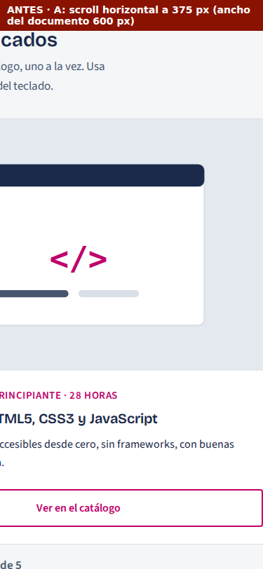

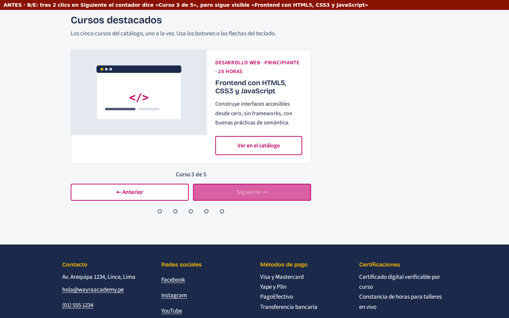

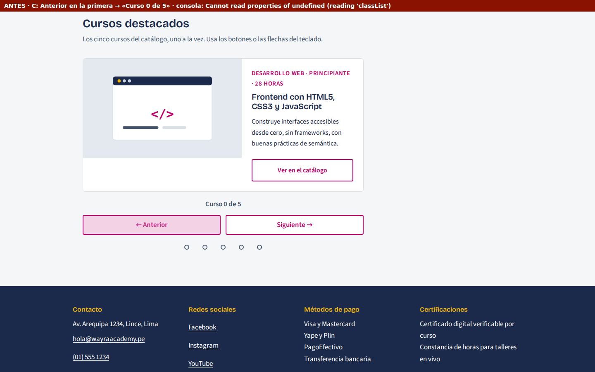

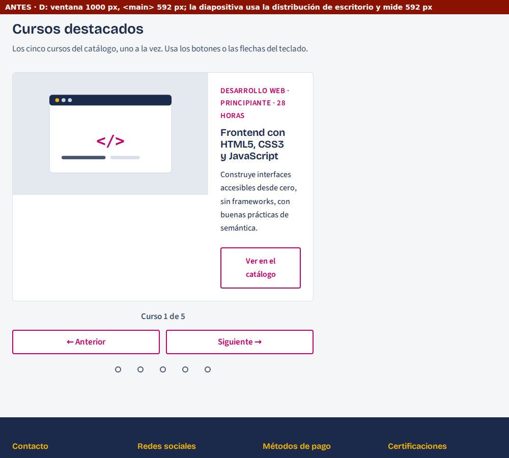

**Después de la corrección:**

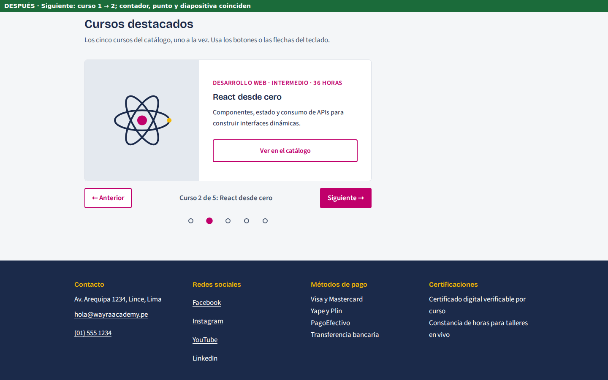

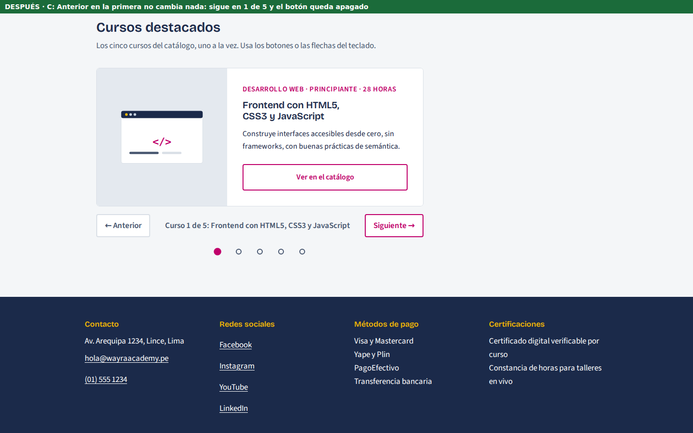

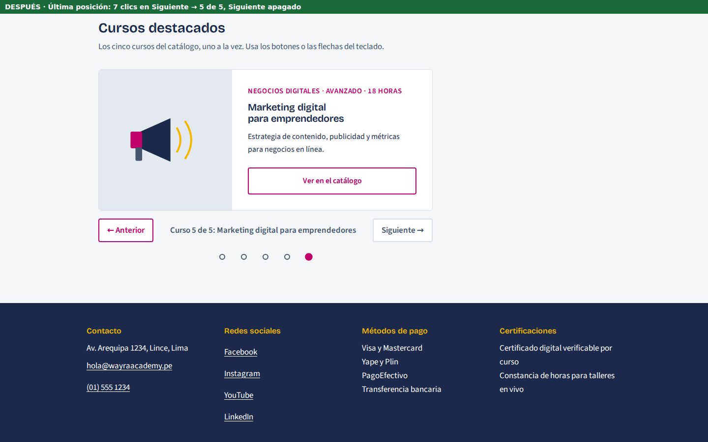

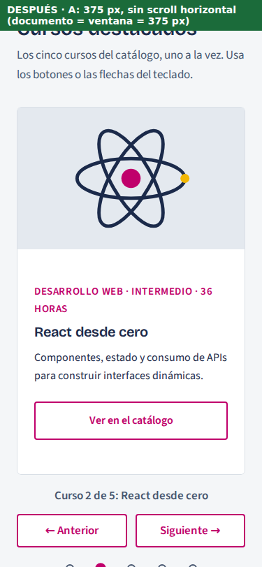

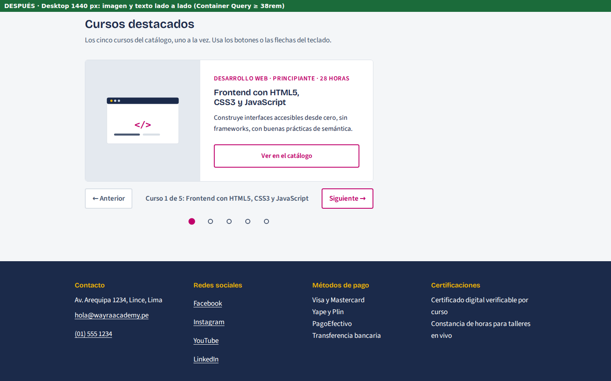

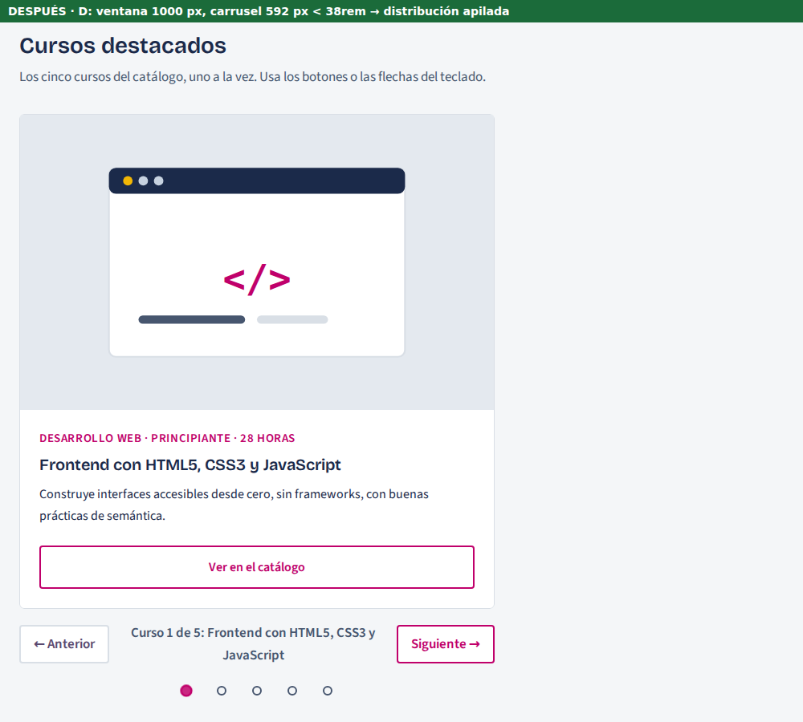

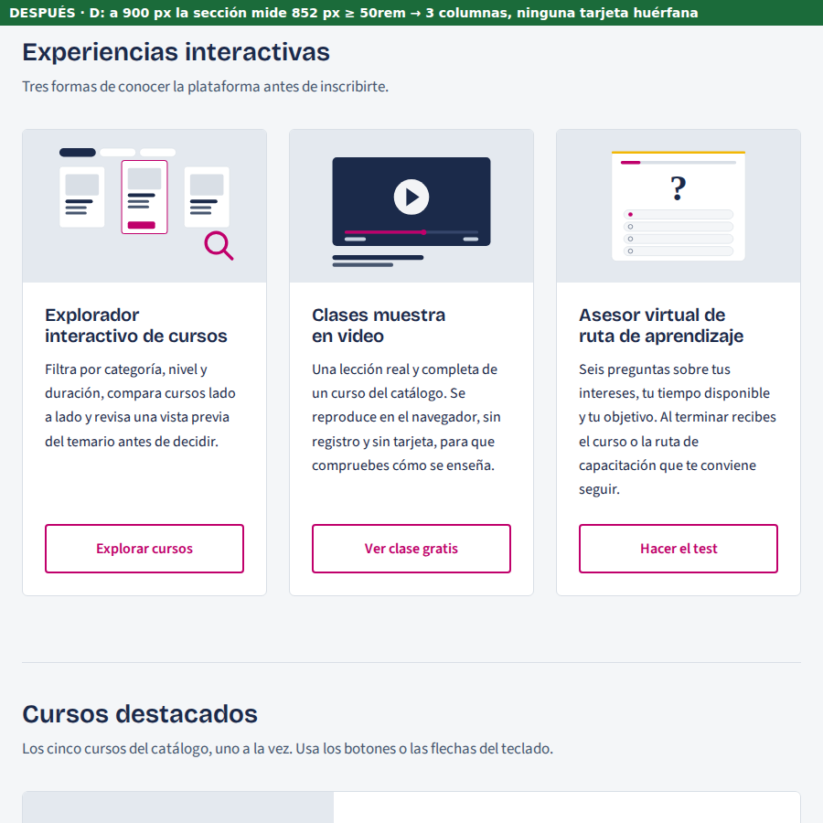

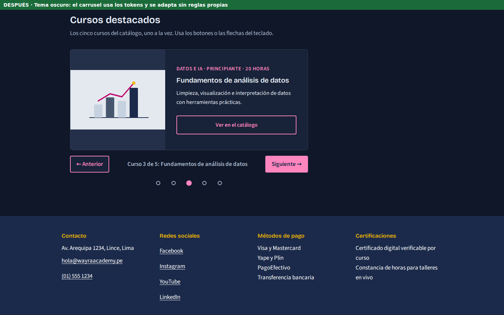

**Decisiones a defender:**

- **CSS — Container Query en vez de media query.** El carrusel no sabe en qué página ni en qué columna
  lo pondrán. A 1000 px de ventana, la media query decía «escritorio» y el carrusel medía 592 px. Con
  `@container carrusel (min-width: 38rem)`, la decisión la toma el ancho real del componente. Si mañana
  lo movemos al `<aside>`, se adapta solo.
- **JavaScript — un solo número de estado y una sola función que pinta.** Los síntomas B, C y E venían
  de actualizar cada cosa por su lado. Con `actual` acotado en `irA()` y todo derivado en `pintar()`, es
  **imposible** que el contador diga 3 y se vea la 1, o que el índice valga −1.

---

## 5. PARTE IV — Tabla de pruebas obligatorias

Ejecutadas en **Chromium** con Playwright sobre un servidor local, además de la revisión manual en el
navegador. Cada «resultado observado» es una medición; los datos crudos están en
`evidencias-plan-b/resultados.json`.

| Prueba | Condición inicial | Acción | Resultado esperado | Resultado observado | ¿Correcto? |
|---|---|---|---|---|---|
| Carrusel – Siguiente | `index.html` a 1440 px, curso 1 de 5 | Clic en «Siguiente» | Pasa al curso 2; contador, diapositiva activa, diapositiva visible y punto coinciden | «Curso 2 de 5: React desde cero» · activa = 2 · en la ventana: «React desde cero» · punto 2 · «Anterior» se habilita | ✅ Sí |
| Carrusel – Anterior | Curso 3 de 5 | Clic en «Anterior» | Vuelve al curso 2 y todo coincide | «Curso 2 de 5: React desde cero» · activa = 2 · punto 2 · foco en «Anterior» | ✅ Sí |
| Primera/última posición | Curso 1 de 5 | 2 clics en «Anterior»; luego 7 clics en «Siguiente» | Se queda en 1 de 5 y luego se detiene en 5 de 5; botón del extremo apagado; sin errores | 1 de 5 con «Anterior» `aria-disabled="true"` · 5 de 5 con «Siguiente» `aria-disabled="true"` · nunca 0 ni 6 · 0 errores | ✅ Sí |
| Responsive – mobile | 375 px y 320 px | Cargar, navegar y medir | Sin scroll horizontal; diapositiva apilada; controles en dos filas | `scrollWidth` = `clientWidth` (375/375 y 320/320) · 1 columna · áreas «contador / anterior siguiente» | ✅ Sí |
| Responsive – desktop | 1440 px; también 1000 y 900 px | Cargar y medir | Imagen y texto lado a lado cuando el **carrusel** mide ≥ 38rem | 1440: carrusel 680 px → 2 columnas (271 + 407 px) · 1000: carrusel 592 px → apilado · 900: carrusel 852 px → 2 columnas · 0 desbordes | ✅ Sí |
| Consola | Todas las pruebas anteriores y las extra | Registrar errores, advertencias y respuestas HTTP ≥ 400 | 0 mensajes | **0** errores, 0 advertencias, 0 respuestas 4xx/5xx. En el borrador: 1 `TypeError` (síntoma C) | ✅ Sí |

**Pruebas adicionales**

| Prueba | Resultado observado |
|---|---|
| Teclado | Enter y Espacio en «Siguiente» → 3 de 5 · Fin → 5 de 5 · Enter en la última → sigue en 5 y **el foco no se pierde** · Inicio → 1 de 5 · Flecha derecha → 2 de 5 |
| Orden de Tab | Solo el enlace de la diapositiva activa es tabulable; las otras 4 tienen `inert` |
| Puntos | Clic en el punto 3 → «Curso 3 de 5: Fundamentos de análisis de datos», `aria-current` solo en el 3 |
| Barrido responsive | 4 páginas × 6 anchos (320–1440) × 2 temas = **48 combinaciones, 0 desbordes** |
| Container Query en «Experiencias» | 900 px: 3 tarjetas de 268 px en la misma fila · 1000 y 1440 px: 2 columnas (decisión de la Semana 2) |
| Tema oscuro | El carrusel toma los tokens del tema, sin reglas nuevas |
| «Reducir movimiento» | Transición de la pista ≈ 0 s (regla global `prefers-reduced-motion`) |
| Sin JavaScript | 5 cursos visibles en lista, controles ocultos, sin scroll horizontal |
| Regresión de la Planeación A | Tema oscuro ✅ · el modal abre y cierra con Esc ✅ · filtro «Desarrollo web» → «2 cursos coinciden» ✅ |

**Resultado: 6 de 6 pruebas obligatorias y 9 de 9 adicionales superadas.**

---

## 6. Evidencias obligatorias de entrega

| Evidencia | Dónde está |
|---|---|
| Respuestas de la Parte I | Sección 2 de este documento |
| Matriz de diagnóstico de la Parte II | Sección 3 |
| Código fuente actualizado | `index.html`, `css/estilos.css`, `js/interaccion.js`, `img/cursos/` |
| Capturas antes/después | `docs/evidencias-plan-b/`: 5 del «antes» (01–05) y 8 del «después» (06–13) |
| Tabla de pruebas | Sección 5, con datos en `evidencias-plan-b/resultados.json` y `antes.json` |
| Revisión de consola | Prueba «Consola» + `resultados.json` (`T14_consola: []`). **Pendiente del equipo:** una captura de DevTools → Consola con 0 errores, tomada en su propio navegador. |
| Video de 6–8 minutos | Guion en la sección 7. **Pendiente de grabación.** |

---

## 7. Guion del video (≈ 7 min)

> Cada integrante debe aparecer **con imagen y nombre visibles** durante su intervención (cámara en
> una esquina y un rótulo con nombre y apellidos).

| Tiempo | Bloque | Integrante | Qué dice / qué muestra |
|---|---|---|---|
| 0:00 – 0:40 | Presentación | **Chauca Machuca, Jhordi Fabian** | Equipo, los 5 integrantes y sus roles. Objetivo: diagnosticar y corregir la integración de una galería en Wayra Academy (el mismo proyecto de las Semanas 1–3) y entregar un carrusel robusto y verificable. |
| 0:40 – 2:00 | Diagnóstico | **Cherca Lopez, Raul** | Muestra la matriz. Pone las capturas del «antes»: 600 px de documento en 375, «Curso 3 de 5» con la 1 visible, «Curso 0 de 5» y el `TypeError`, el texto de 206 px. Explica **cómo** encontraron cada causa: el script de desbordes, el registro del estado y la medición de `<main>`. |
| 2:00 – 2:40 | Decisiones: HTML | **Malpartida Sanchez, Yvette** | `<section>` con `<h2>`, 5 `<article>` con `<h3>`, `<button>` y no `<div>`. `aria-roledescription`, `aria-live` en el contador y nombres de los puntos. Sin JS es una lista. |
| 2:40 – 3:30 | Decisiones: responsive | **Patiño Ramos, Jorge Luis** | En VS Code: `flex: 0 0 100%` + `min-width: 0`, `overflow: clip`. Por qué Container Query: a 1000 px, `<main>` mide 592. Grid con `grid-template-areas` en los controles. «Experiencias» con 3 columnas a 900 px. |
| 3:30 – 4:10 | Decisiones: JavaScript | **Tesen Tantachuco, José Antonio** | Estado = `actual`. `irA()` acota con `Math.min`/`Math.max`. `pintar()` deriva todo. `classList.toggle(clase, condición)`. `inert`. `aria-disabled` frente a `disabled`. |
| 4:10 – 6:10 | Demostración | **Tesen** (carrusel) y **Patiño** (responsive) | En vivo: Siguiente/Anterior, llegar a la primera y a la última, puntos y teclado (Tab, Enter, flechas). DevTools a 375 y 320 px: sin scroll. 1440 y 1000 px: el carrusel cambia según su contenedor. Tema oscuro. Consola en 0. Tabla de pruebas en pantalla. |
| 6:10 – 7:10 | Cierre | **Los cinco, ~12 s cada uno** | Aporte y una decisión técnica que puede defender (tabla siguiente). |

| Integrante | Aporte | Decisión técnica que defiende |
|---|---|---|
| Chauca Machuca, Jhordi Fabian | Coordinación, prioridades de la matriz e integración en `index.html` | Corregir primero C (rompe el script) y luego B/E, porque comparten causa |
| Tesen Tantachuco, José Antonio | JavaScript del carrusel | Un solo número de estado acotado y una sola función que pinta |
| Patiño Ramos, Jorge Luis | Responsive y Container Queries | `@container` en vez de `@media`: el hueco real no es la ventana |
| Malpartida Sanchez, Yvette | HTML semántico y accesibilidad | `aria-disabled` y no `disabled`, para no perder el foco en los extremos |
| Cherca Lopez, Raul | QA, pruebas, evidencias y video | Medir `scrollWidth` frente a `clientWidth` en vez de «mirar si se ve bien» |

---

## 8. Checklist final

- [x] Trabajamos sobre el mismo proyecto de las Semanas 1–3.
- [x] Respondimos la Parte I con razonamiento técnico.
- [x] Completamos la matriz antes de modificar el código.
- [x] Corregimos el problema responsive.
- [x] Implementamos el carrusel Anterior/Siguiente.
- [x] Probamos la primera y la última posición.
- [x] Probamos mobile y desktop.
- [x] Revisamos la consola. *(falta la captura manual de DevTools)*
- [x] Completamos la tabla de pruebas.
- [x] Guardamos el código y las evidencias.
- [ ] Video grupal de 6–8 minutos. *(guion listo; falta grabar)*
- [ ] Todos aparecen con imagen y nombre. *(al grabar)*
- [ ] Todos explican su aporte y pueden defender una decisión técnica. *(al grabar)*
- [x] Todos sabemos que la siguiente prueba será individual.
