# Wayra Academy — Semana 4, Planeación B: Laboratorio de Experiencias Web Inmersivas

**Desarrollo Web Full Stack – FrontEnd** · Evaluación de conocimiento grupal · 20 puntos · 3 horas

| | |
|---|---|
| Proyecto | Wayra Academy: el mismo producto de las Semanas 1, 2 y 3 (y de la Planeación A) |
| Fecha | 26 de septiembre de 2026 |
| Repositorio | `DesarrolloWebFullStack/` (HTML, CSS y JavaScript nativos, sin frameworks) |
| Producto | Carrusel «Cursos destacados» en `index.html` + corrección responsive con Container Queries |

**Integrantes y roles operativos**

| Integrante | Rol |
|---|---|
| Chauca Machuca, Jhordi Fabian | Coordinación |
| Tesen Tantachuco, José Antonio | JavaScript / interacción |
| Patiño Ramos, Jorge Luis | CSS / responsive |
| Malpartida Sanchez, Yvette | HTML / semántica |
| Cherca Lopez, Raul | QA / documentación / video |

> Los roles organizan el trabajo, pero no reparten la nota: todos revisamos la solución completa. El
> reparto es una **propuesta**. Ajústenlo para que refleje lo que hizo cada uno.

---

## 1. Relación con la Planeación A

La **Planeación A** (`SEMANA-4-INTEGRACION.md`) cubrió la interactividad básica: DOM, eventos,
`classList`, formulario validado, modal animado y tema oscuro. Esta **Planeación B** no repite eso.
Mueve el reto a la **integración**: diagnosticar antes de programar, corregir el layout con
Grid/Flexbox/**Container Queries** y agregar un **carrusel Anterior/Siguiente** con estado controlado.

Seguimos las reglas de la evaluación:

- Todo se hizo **sobre el mismo proyecto**. El carrusel es una nueva sección de `index.html`, no una
  página aparte.
- La **matriz de diagnóstico** (sección 3) se llenó **antes** de escribir el código definitivo.
- Cada cambio responde a un síntoma de la matriz (A–E) y tiene su justificación.

**Cómo obtuvimos el «antes».** Primero integramos un **borrador rápido** del carrusel, como haría
cualquier equipo con prisa: una diapositiva visible con `display`, un contador que suma 1 y un
`min-width` pensado para escritorio. Ese borrador reprodujo **los cinco síntomas del caso** (A–E), y los
medimos y capturamos (sección 4.3). Después lo corregimos. El borrador no quedó en el proyecto: solo
quedan sus capturas y mediciones (`evidencias-plan-b/antes.json`).

---

## 2. PARTE I — Evaluación teórico-práctica

### 1. Scroll horizontal en mobile: ¿qué revisar primero en HTML, luego en CSS y al final en JavaScript?

Vamos **de la capa que todo lo sostiene a la que cambia en tiempo de ejecución**. Además, cada paso es
más barato de verificar que el siguiente.

1. **HTML primero.** Si falta `<meta name="viewport" content="width=device-width">`, el móvil dibuja la
   página a 980 px y ningún CSS lo arregla. Después revisamos el contenido que trae su propio ancho:
   imágenes con `width="800"`, tablas, `<pre>`, URL largas sin cortes o `<iframe>`. En Wayra las
   imágenes llevan `width`/`height` (para reservar espacio y evitar saltos), así que dependen de la
   regla `img { max-width: 100% }`.
2. **CSS después.** Es la causa más común. Buscamos anchos fijos o mínimos (`width`, `min-width`),
   `100vw` (incluye la barra de desplazamiento), márgenes negativos, elementos de Flex o Grid sin
   `min-width: 0` y contenidos que se mueven con `transform` sin un contenedor que los recorte.
   **En nuestro caso fue aquí:** el borrador del carrusel tenía `.diapositiva { min-width: 36rem }` y el
   documento medía **600 px en una pantalla de 375 px**.
3. **JavaScript al final.** Solo si el scroll aparece **después** de interactuar: estilos en línea que
   escribe el script, nodos que crea o una pista que desplaza con `translateX`. Para saberlo, cargamos la
   página, medimos, interactuamos y volvemos a medir.

**Herramienta.** En DevTools, modo móvil, ejecutamos en la consola este script para encontrar al
culpable en vez de adivinarlo:

```js
[...document.querySelectorAll("body *")]
  .filter(e => e.getBoundingClientRect().right > document.documentElement.clientWidth)
```

### 2. En una galería de tarjetas: ¿qué hace Grid, qué hace Flexbox y qué hacen las Container Queries?

| Herramienta | Responsabilidad | Ejemplo concreto en Wayra |
|---|---|---|
| **CSS Grid** | Distribución **bidimensional**: columnas y filas a la vez, y áreas con nombre | `.experiencias__grilla` reparte las 3 tarjetas en 1, 2 o 3 columnas. La barra `.carrusel__controles` usa `grid-template-areas`: en caja estrecha pone el contador arriba y los botones abajo, y en caja ancha, «anterior · contador · siguiente». |
| **Flexbox** | Distribución **en un solo eje**, repartiendo el espacio sobrante | `.carrusel__pista` pone las 5 diapositivas en fila, cada una con `flex: 0 0 100%`. `.tarjeta__cuerpo` es una columna flex donde el texto crece (`flex-grow: 1`), así los botones de las 3 tarjetas quedan alineados abajo. |
| **Container Queries** | El componente decide su forma según el ancho **de su contenedor**, no el de la pantalla | `.carrusel` es un contenedor (`container: carrusel / inline-size`). A partir de `38rem` de **carrusel**, la diapositiva pone la imagen y el texto lado a lado. A 1000 px de ventana, `<main>` mide 592 px, así que se queda apilada. Una media query ahí se equivocaba (síntoma D). |

Regla práctica que aplicamos: **Grid para el esqueleto, Flexbox para alinear dentro de una pieza y
Container Queries para que la pieza se adapte al hueco donde la pongan.**

### 3. Seis elementos `.card` y solo uno activo

```js
const tarjetas = document.querySelectorAll(".card");   // NodeList con las 6

function activar(indice) {
  // Un solo recorrido: la clase queda en la elegida y se quita de las otras 5.
  tarjetas.forEach((tarjeta, i) => {
    tarjeta.classList.toggle("card--activa", i === indice);
  });
}

tarjetas.forEach((tarjeta, i) => {
  tarjeta.addEventListener("click", () => activar(i));
});
```

`classList.toggle(clase, condición)` con segundo argumento **fuerza** el estado: `true` agrega la clase y
`false` la quita. Así no hace falta recordar cuál estaba activa antes: el bucle deja **exactamente una**.
En el carrusel usamos el mismo patrón con las 5 diapositivas (`diapositiva--activa`) y con los 5 puntos
(`aria-current`).

### 4. Carrusel de cinco imágenes: ¿qué estado mínimo necesita JavaScript?

**Un solo número:** el índice activo (`let actual = 0`, de 0 a 4). El total sale de
`diapositivas.length`, no se guarda aparte. Todo lo demás **se deriva** de `actual` en una única función
`pintar()`: la diapositiva visible, el punto marcado, el texto «Curso 2 de 5», el valor de la pista y qué
botón está apagado. Si guardáramos el texto o la clase por separado, podrían desincronizarse (síntoma E).

**En la primera y la última posición** decidimos **no dar la vuelta** (sin *wrap*):

- En la **primera** (0), «Anterior» queda con `aria-disabled="true"`. Si igual se pulsa, el índice se
  **acota**: `Math.max(0, actual - 1)` sigue siendo 0. Nunca existe la posición −1.
- En la **última** (4), «Siguiente» se apaga igual y `Math.min(total - 1, actual + 1)` se queda en 4.
- Usamos `aria-disabled` y **no** `disabled`: un botón `disabled` pierde el foco, y quien llega a la
  última con el teclado quedaría con el foco en ninguna parte.

### 5. ¿Por qué «sin errores en consola» no significa «bien implementado»?

La consola solo muestra **excepciones** y fallos de red. No sabe qué debía pasar. Un código puede ser
válido y hacer otra cosa: sumar el índice pero marcar siempre la primera tarjeta, mostrar «Curso 3 de 5»
con la 1 en pantalla o dejar un scroll horizontal por CSS. **Nuestro borrador tenía los síntomas B, D y
E con la consola en 0 errores.** Solo el síntoma C lanzó un `TypeError`. Por eso las pruebas comparan lo
**esperado** con lo **observado**.

| Tipo | Prueba | Esperado |
|---|---|---|
| Funcional 1 | Desde el curso 1, pulsar «Siguiente» una vez | Contador «Curso 2 de 5», se ve el curso 2, el punto 2 marcado y solo 1 diapositiva activa |
| Funcional 2 | En el curso 1, pulsar «Anterior» 2 veces; luego «Siguiente» 7 veces | Se queda en 1 de 5 con «Anterior» apagado; luego se detiene en 5 de 5 con «Siguiente» apagado; 0 errores |
| Responsive | A 375 px y a 320 px, medir `scrollWidth` frente a `clientWidth` después de navegar | Son iguales: no hay scroll horizontal; los controles pasan a dos filas |

---

## 3. PARTE II — Matriz de diagnóstico (llenada antes de corregir)

| Síntoma | Posible causa | Elemento / evento | Corrección propuesta | Cómo verificar |
|---|---|---|---|---|
| **A. Scroll horizontal en mobile** | Diapositiva con ancho mínimo de escritorio (`min-width: 36rem` = 576 px) y pista sin recorte. El contenido se sale del viewport. | `.diapositiva`, `.carrusel__ventana` · carga de la página y `resize` | Quitar el ancho fijo: `flex: 0 0 100%` + `min-width: 0`. Recortar con `overflow: clip` en la ventana del carrusel. | `scrollWidth === clientWidth` a 320 y 375 px, antes y después de navegar. Barrido de 4 páginas × 6 anchos × 2 temas. |
| **B. «Siguiente» no cambia** | El manejador suma el índice, pero aplica la clase con `querySelector(".diapositiva")`, que **siempre** devuelve la primera. Además nunca quita la clase anterior. | `#carrusel-siguiente` · `click` | Seleccionar todas con `querySelectorAll` y, en un bucle, `classList.toggle("diapositiva--activa", i === actual)`. | Tras 1 clic: el título en la ventana es «React desde cero» y la diapositiva activa es la 2. |
| **C. «Anterior» en la primera posición** | `indice--` sin límite: el índice pasa a −1, el contador dice «Curso 0 de 5» y `diapositivas[-1]` es `undefined` → `TypeError` en la consola. | `#carrusel-anterior` · `click` | Una función `irA()` que **acota** el índice entre 0 y `total − 1`. Botón con `aria-disabled="true"` en los extremos. | En la posición 1, 2 clics en «Anterior» → sigue 1 de 5. En la 5, 7 clics en «Siguiente» → sigue 5 de 5. Consola en 0. |
| **D. Layout de escritorio en contenedor pequeño** | Distribución decidida con `@media` de **ventana**. A 1000 px de ventana, `<main>` mide 592 px: la imagen ocupaba 384 px y el texto quedaba en 206 px. En «Experiencias», a 900 px la tercera tarjeta quedaba sola en su fila. | `.diapositiva`, `.experiencias__grilla` · cambio de ancho | **Container Queries**: `.carrusel` y `.experiencias` pasan a ser contenedores. La diapositiva va lado a lado desde `38rem` de carrusel, y la grilla usa 2 columnas desde `34rem` y 3 desde `50rem` de sección. | A 1000 px la diapositiva está apilada (1 columna). A 900 px, lado a lado. A 900 px, «Experiencias» tiene 3 columnas en la misma fila. |
| **E. Estado visual no se actualiza** | El texto del contador y la clase activa se cambian en lugares distintos del código. El texto se actualiza y la clase no. | `#carrusel-contador`, `.diapositiva--activa`, `.carrusel__punto` · `click` | **Una sola fuente de verdad** (`actual`) y **una sola función** `pintar()` que deriva todo: pista, clase, `inert`, `aria-current`, contador y `aria-disabled`. | En cada prueba se comprueba que contador, diapositiva activa, diapositiva visible y punto marcado **coinciden**. |

**Cómo determinamos las causas.** No adivinamos:

1. **A:** con el script de la pregunta 1, el elemento que se salía era `.diapositiva` (600 px). En
   DevTools, la regla culpable era `min-width: 36rem`.
2. **B y E:** registramos en la consola, tras cada clic, el índice, el contador y la lista de clases de
   las 5 diapositivas. El índice y el texto cambiaban, pero la clase seguía en la primera.
3. **C:** la consola mostró `Cannot read properties of undefined (reading 'classList')`. El contador
   decía «Curso 0 de 5».
4. **D:** medimos `<main>` con `getBoundingClientRect()`: 592 px con una ventana de 1000 px. La media
   query miraba la ventana (1000 px), no el hueco real.

**Prioridad.** Primero **C**, porque rompe el script y deja un estado inválido. Después **B/E**, que
comparten causa (el estado no controla la vista). Luego **A**, porque impide usar el móvil. Al final
**D**, que se ve mal pero es usable.

---

## 4. PARTE III — Implementación práctica

### Archivos tocados

| Archivo | Cambio |
|---|---|
| `index.html` | Nueva sección `<section id="destacados">` con el carrusel dentro de `<main>`: 5 `<article>`, controles y puntos. |
| `css/estilos.css` | Nuevo bloque «Carrusel de cursos destacados» y Container Queries del carrusel y de «Experiencias». La grilla de experiencias sale de la media query de ventana. |
| `js/interaccion.js` | Nuevo bloque **D**, `iniciarCarrusel()`: estado, `irA()`, `pintar()`, clics y teclado. |
| `img/cursos/*.svg` | **Nuevos.** 5 portadas planas, una por curso, con los colores del sistema de diseño. |

Las 3 páginas restantes no cambian. El carrusel reutiliza tokens, `.boton` y `.solo-con-js` de la
Planeación A.

### Actividad A — Corrección de responsividad e integración

| Qué cambió | Por qué |
|---|---|
| `.diapositiva`: sale `min-width: 36rem`; entra `flex: 0 0 100%` + `min-width: 0` | **A.** Cada diapositiva mide exactamente la ventana del carrusel. `min-width: 0` anula el tamaño mínimo automático de un elemento flex, que es su contenido. |
| `.con-js .carrusel__ventana { overflow: clip }` | **A.** Las 4 diapositivas ocultas quedan a la derecha de la visible. `clip` las recorta **sin** crear un contenedor de desplazamiento, así no se pueden arrastrar con la rueda ni con Tab (`hidden` sí lo permitiría). |
| `.carrusel { container: carrusel / inline-size }` + `@container carrusel (min-width: 38rem)` | **D.** El carrusel va en `<main>`, cuyo ancho **no** sigue a la ventana: a 991 px mide 943 px y a 992 px, 592 px, porque aparece el `<aside>`. Solo una Container Query sabe cuánto mide el hueco. |
| `@container carrusel (min-width: 30rem)` en `.carrusel__controles` | En caja estrecha: contador arriba y botones en dos mitades. En caja ancha: una sola fila. Se hace con `grid-template-areas`, sin tocar el orden del HTML, así que el orden de Tab no cambia. |
| `.experiencias` pasa a contenedor: 2 columnas desde `34rem`, 3 desde `50rem` | **D.** Antes, `repeat(2, 1fr)` desde 40em de **ventana**: entre unos 830 y 991 px, la tercera tarjeta quedaba sola y a media anchura. Desde 992 px seguimos con 2 columnas: es la decisión de la Semana 2, porque 3 tarjetas junto al `<aside>` quedarían en unos 210 px. |
| Estructura semántica | Se conserva: un solo `<h1>`, la sección nueva con `<h2>` y cada curso con `<article>` + `<h3>`. Nada de `<div>` clicables: los controles son `<button>`. |

**Anchos probados:** 320, 375, 768, 900, 1000, 1280 y 1440 px, en los dos temas.

### Actividad B — Carrusel interactivo Anterior/Siguiente

| Requisito | Cómo se cumple |
|---|---|
| Contenido real | Los **5 cursos del catálogo** de `explorador-cursos.html`, con su categoría, nivel, horas y descripción. Cada uno enlaza al catálogo. |
| Botones con JS nativo | `<button id="carrusel-anterior">` y `<button id="carrusel-siguiente">` con `click`. Sin librerías. |
| Estado del activo | `let actual`: un número. `irA()` es la única función que lo cambia y `pintar()` la única que lo dibuja. |
| Primera y última sin estados inválidos | `Math.min(Math.max(indice, 0), total - 1)` y `aria-disabled` en el extremo. |
| DOM sin duplicar | Las 5 diapositivas se escriben **una vez** en el HTML. JavaScript no crea ni copia tarjetas: solo cambia `--indice`, una clase, `inert`, `aria-current`, `aria-disabled` y el texto del contador. |
| Integrado con el responsive | Container Queries propias, tokens del sistema (funciona en tema oscuro sin reglas nuevas) y 0 desbordes en 48 combinaciones. |
| Controles comprensibles y con teclado | «← Anterior», «Siguiente →». Puntos con nombre propio («Curso 3: Fundamentos de análisis de datos»). Enter y Espacio nativos. Flechas ←/→, Inicio y Fin sobre los controles. Contador con `aria-live="polite"`: el lector anuncia el curso nuevo. |

```js
function irA(indice) {
  const acotado = Math.min(Math.max(indice, 0), total - 1);  // nunca -1 ni 5
  if (acotado === actual) return;
  actual = acotado;
  pintar();
}

function pintar() {
  pista.style.setProperty("--indice", actual);     // el CSS decide cómo se mueve
  for (const [i, diapositiva] of diapositivas.entries()) {
    const activa = i === actual;
    diapositiva.classList.toggle("diapositiva--activa", activa);  // exactamente una
    diapositiva.inert = !activa;                   // las ocultas salen del orden de Tab
  }
  // ... puntos (aria-current), contador y aria-disabled, todo desde «actual»
}
```

```css
.con-js .carrusel__pista {
  display: flex;
  transform: translateX(calc(var(--indice, 0) * -100%));
  transition: transform 300ms ease-out;   /* se apaga con prefers-reduced-motion */
}
```

**Mejora progresiva (igual que en la Planeación A).** Sin JavaScript, los 5 cursos se ven como una lista
vertical y los controles no aparecen (`.solo-con-js`). Con JavaScript, el carrusel se arma desde el
primer cuadro: `.con-js` se pone en `<head>`, así que no hay saltos al cargar.

### Actividad C — Depuración y defensa técnica

**Evidencia del problema antes de corregir** (borrador, mediciones en `evidencias-plan-b/antes.json`):

| Síntoma | Medición antes | Captura |
|---|---|---|
| A | Documento de **600 px** en una pantalla de 375 px | `01-antes-A-scroll-horizontal-375.png` |
| B + E | 2 clics en «Siguiente» → contador «Curso 3 de 5», diapositiva activa: la **1** | `02-antes-B-E-siguiente-no-cambia.png` |
| C | «Anterior» en la primera → «Curso **0** de 5» + `TypeError: Cannot read properties of undefined (reading 'classList')` | `03-antes-C-anterior-estado-invalido.png` |
| D | Ventana de 1000 px, `<main>` de 592 px: imagen de 384 px y texto de **206 px** | `04-antes-D-layout-escritorio-en-caja-pequena.png` |
| D | 900 px: tarjetas de 414 px y la tercera sola en su fila | `05-antes-D-experiencias-900.png` |

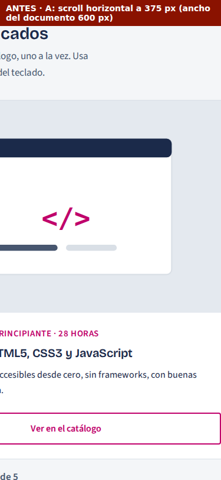

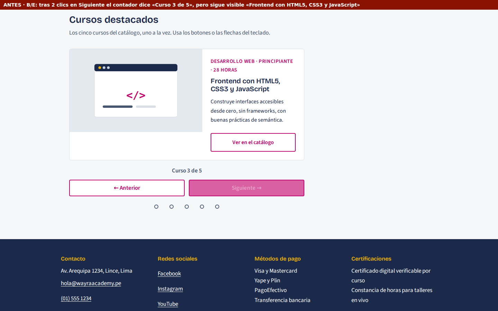

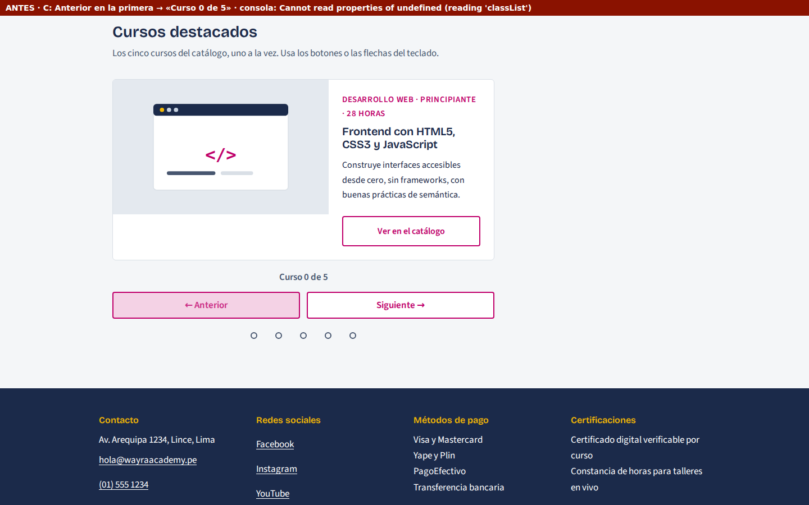

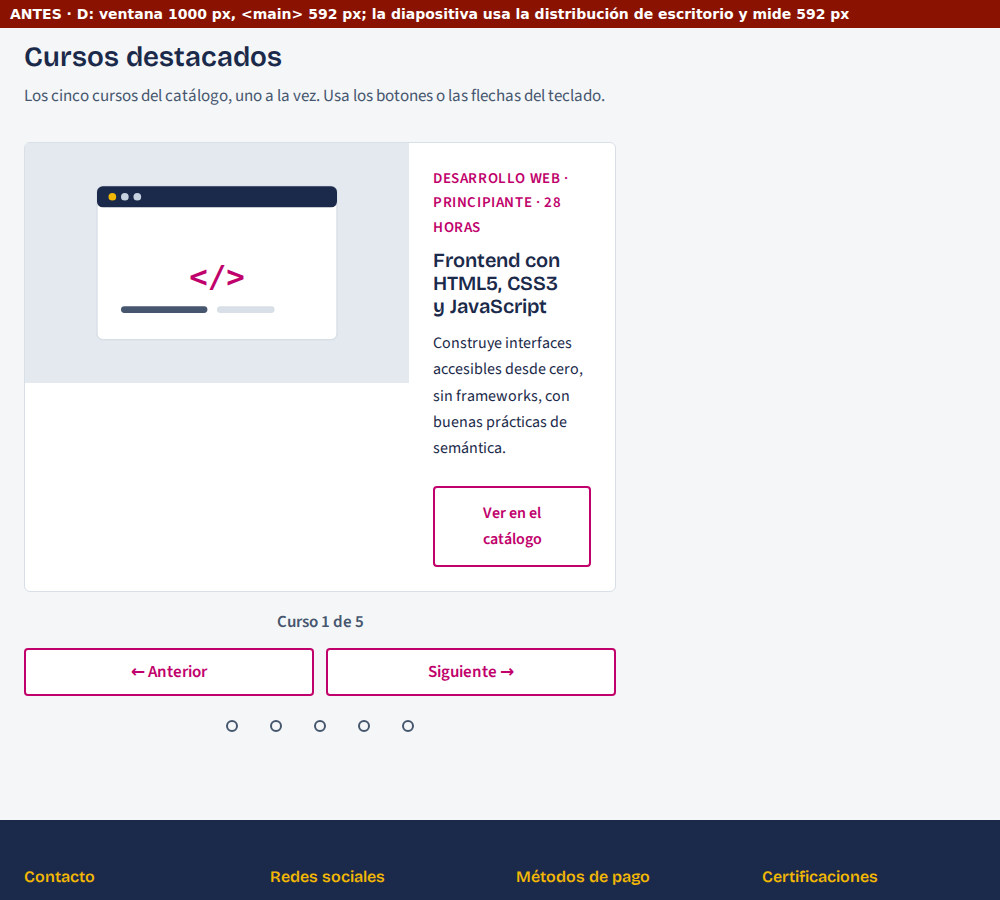

**Después de la corrección:**

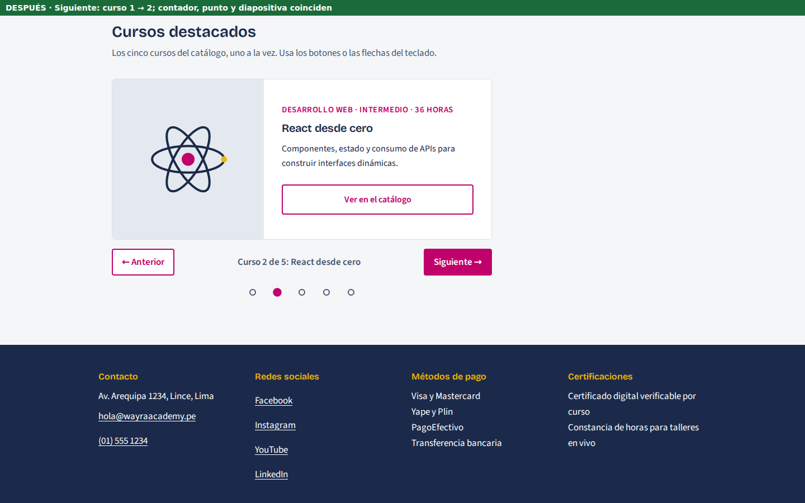

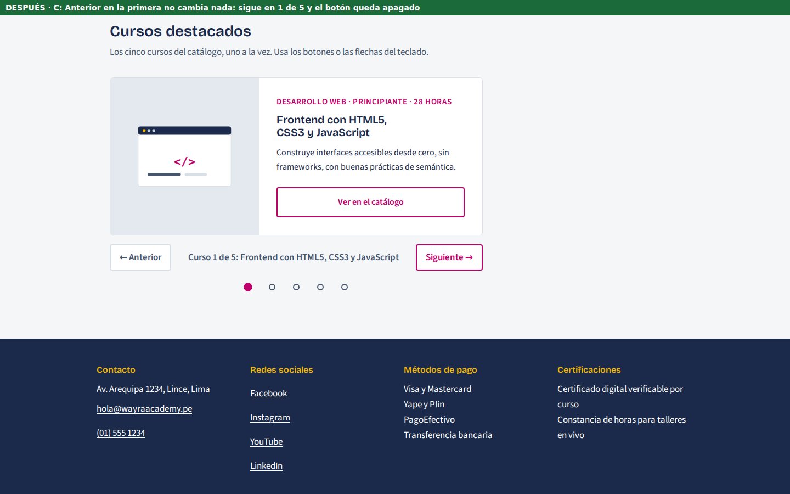

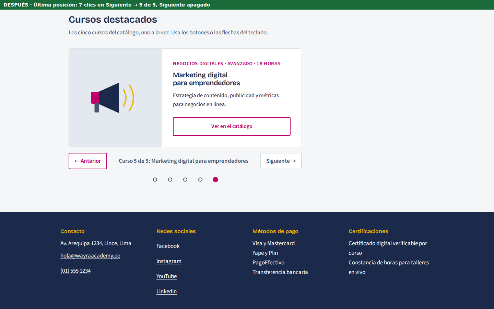

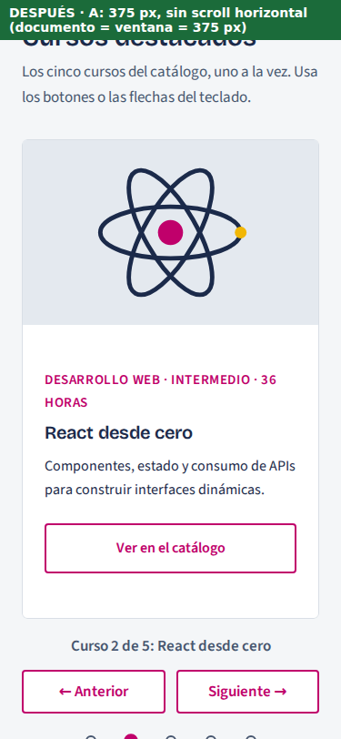

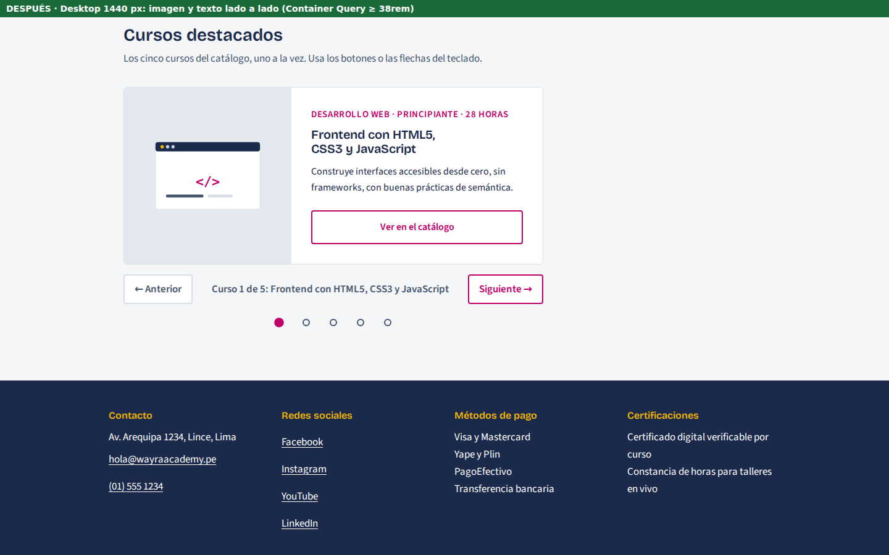

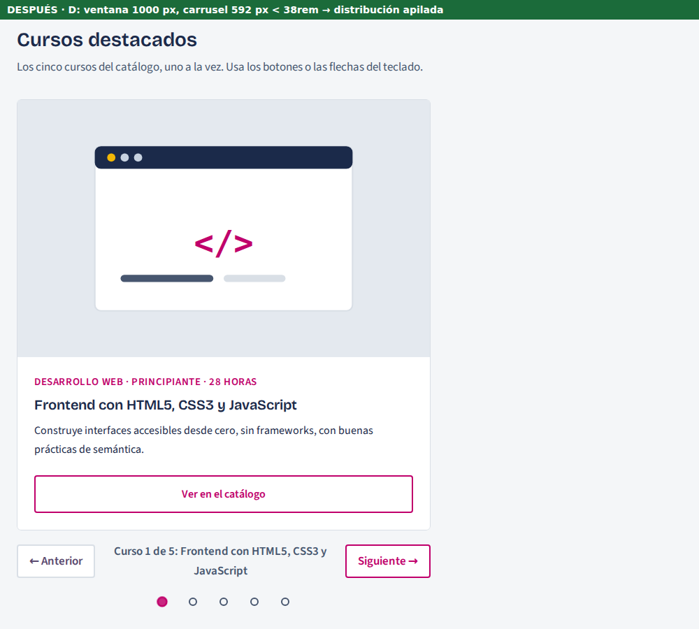

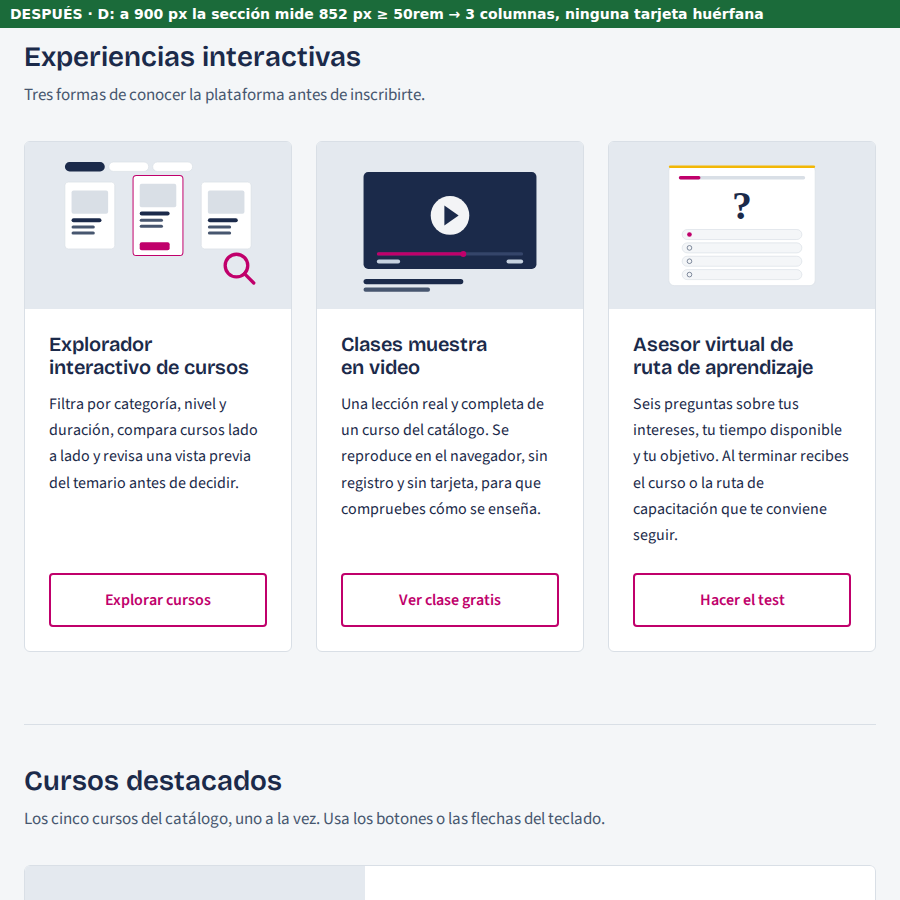

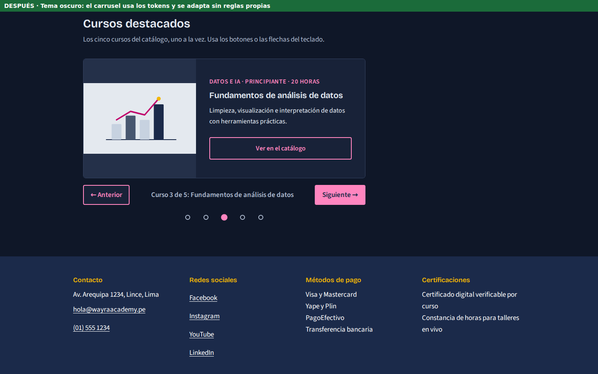

**Decisiones a defender:**

- **CSS — Container Query en vez de media query.** El carrusel no sabe en qué página ni en qué columna
  lo pondrán. A 1000 px de ventana, la media query decía «escritorio» y el carrusel medía 592 px. Con
  `@container carrusel (min-width: 38rem)`, la decisión la toma el ancho real del componente. Si mañana
  lo movemos al `<aside>`, se adapta solo.
- **JavaScript — un solo número de estado y una sola función que pinta.** Los síntomas B, C y E venían
  de actualizar cada cosa por su lado. Con `actual` acotado en `irA()` y todo derivado en `pintar()`, es
  **imposible** que el contador diga 3 y se vea la 1, o que el índice valga −1.

---

## 5. PARTE IV — Tabla de pruebas obligatorias

Ejecutadas en **Chromium** con Playwright sobre un servidor local, además de la revisión manual en el
navegador. Cada «resultado observado» es una medición; los datos crudos están en
`evidencias-plan-b/resultados.json`.

| Prueba | Condición inicial | Acción | Resultado esperado | Resultado observado | ¿Correcto? |
|---|---|---|---|---|---|
| Carrusel – Siguiente | `index.html` a 1440 px, curso 1 de 5 | Clic en «Siguiente» | Pasa al curso 2; contador, diapositiva activa, diapositiva visible y punto coinciden | «Curso 2 de 5: React desde cero» · activa = 2 · en la ventana: «React desde cero» · punto 2 · «Anterior» se habilita | ✅ Sí |
| Carrusel – Anterior | Curso 3 de 5 | Clic en «Anterior» | Vuelve al curso 2 y todo coincide | «Curso 2 de 5: React desde cero» · activa = 2 · punto 2 · foco en «Anterior» | ✅ Sí |
| Primera/última posición | Curso 1 de 5 | 2 clics en «Anterior»; luego 7 clics en «Siguiente» | Se queda en 1 de 5 y luego se detiene en 5 de 5; botón del extremo apagado; sin errores | 1 de 5 con «Anterior» `aria-disabled="true"` · 5 de 5 con «Siguiente» `aria-disabled="true"` · nunca 0 ni 6 · 0 errores | ✅ Sí |
| Responsive – mobile | 375 px y 320 px | Cargar, navegar y medir | Sin scroll horizontal; diapositiva apilada; controles en dos filas | `scrollWidth` = `clientWidth` (375/375 y 320/320) · 1 columna · áreas «contador / anterior siguiente» | ✅ Sí |
| Responsive – desktop | 1440 px; también 1000 y 900 px | Cargar y medir | Imagen y texto lado a lado cuando el **carrusel** mide ≥ 38rem | 1440: carrusel 680 px → 2 columnas (271 + 407 px) · 1000: carrusel 592 px → apilado · 900: carrusel 852 px → 2 columnas · 0 desbordes | ✅ Sí |
| Consola | Todas las pruebas anteriores y las extra | Registrar errores, advertencias y respuestas HTTP ≥ 400 | 0 mensajes | **0** errores, 0 advertencias, 0 respuestas 4xx/5xx. En el borrador: 1 `TypeError` (síntoma C) | ✅ Sí |

**Pruebas adicionales**

| Prueba | Resultado observado |
|---|---|
| Teclado | Enter y Espacio en «Siguiente» → 3 de 5 · Fin → 5 de 5 · Enter en la última → sigue en 5 y **el foco no se pierde** · Inicio → 1 de 5 · Flecha derecha → 2 de 5 |
| Orden de Tab | Solo el enlace de la diapositiva activa es tabulable; las otras 4 tienen `inert` |
| Puntos | Clic en el punto 3 → «Curso 3 de 5: Fundamentos de análisis de datos», `aria-current` solo en el 3 |
| Barrido responsive | 4 páginas × 6 anchos (320–1440) × 2 temas = **48 combinaciones, 0 desbordes** |
| Container Query en «Experiencias» | 900 px: 3 tarjetas de 268 px en la misma fila · 1000 y 1440 px: 2 columnas (decisión de la Semana 2) |
| Tema oscuro | El carrusel toma los tokens del tema, sin reglas nuevas |
| «Reducir movimiento» | Transición de la pista ≈ 0 s (regla global `prefers-reduced-motion`) |
| Sin JavaScript | 5 cursos visibles en lista, controles ocultos, sin scroll horizontal |
| Regresión de la Planeación A | Tema oscuro ✅ · el modal abre y cierra con Esc ✅ · filtro «Desarrollo web» → «2 cursos coinciden» ✅ |

**Resultado: 6 de 6 pruebas obligatorias y 9 de 9 adicionales superadas.**

---

## 6. Evidencias obligatorias de entrega

| Evidencia | Dónde está |
|---|---|
| Respuestas de la Parte I | Sección 2 de este documento |
| Matriz de diagnóstico de la Parte II | Sección 3 |
| Código fuente actualizado | `index.html`, `css/estilos.css`, `js/interaccion.js`, `img/cursos/` |
| Capturas antes/después | `docs/evidencias-plan-b/`: 5 del «antes» (01–05) y 8 del «después» (06–13) |
| Tabla de pruebas | Sección 5, con datos en `evidencias-plan-b/resultados.json` y `antes.json` |
| Revisión de consola | Prueba «Consola» + `resultados.json` (`T14_consola: []`). **Pendiente del equipo:** una captura de DevTools → Consola con 0 errores, tomada en su propio navegador. |
| Video de 6–8 minutos | Guion con texto por integrante en la sección 7. **Pendiente de grabación.** |

---

## 7. Guion del video (≈ 7 min 20 s)

Este guion dice **qué hace cada integrante en su pantalla y qué dice, paso a paso**. Lo que está entre
comillas es el texto para decir. Pueden decirlo con sus palabras, pero **sin cambiar los datos**
(600 px, 592 px, «Curso 0 de 5», 48 combinaciones…): son mediciones reales del proyecto.

### 7.1 Preparación antes de grabar (10 minutos, una sola vez)

**Forma de grabar.** Reunión en Meet, Zoom o Teams, grabada. Cada integrante **comparte su propia
pantalla** cuando le toca y deja la **cámara encendida**. El nombre de cada uno en la reunión debe ser el
**nombre completo** (así aparece como rótulo): «Chauca Machuca, Jhordi Fabian», «Tesen Tantachuco, José
Antonio», «Patiño Ramos, Jorge Luis», «Malpartida Sanchez, Yvette», «Cherca Lopez, Raul».

**Cada integrante tiene listo, antes de empezar:**

| Qué | Cómo dejarlo listo |
|---|---|
| Proyecto abierto en VS Code | Carpeta `DesarrolloWebFullStack`. Zoom del editor en 150 % (`Ctrl` + `+` dos veces) para que el código se lea en el video. |
| Página funcionando | Clic derecho en `index.html` → **Open with Live Server**. Queda en `http://127.0.0.1:5500/index.html`. Sin Live Server: doble clic en `index.html`. |
| Navegador | Chrome o Edge, zoom al 100 %, **sin otras pestañas**, en tema claro, con el carrusel en el curso 1 (recargar con `F5`). |
| Documento | `docs/SEMANA-4-PLAN-B.docx` abierto (lo usan Raul y Jhordi). |
| Capturas | Carpeta `docs/evidencias-plan-b` abierta en el Explorador de Windows (la usa Raul). |
| Notificaciones | Desactivadas (Windows: *Asistente de concentración*). Cerrar WhatsApp y el correo. |

**Quién prepara qué en su pantalla:**

| Integrante | Deja abierto antes de su turno |
|---|---|
| Chauca Machuca, Jhordi Fabian | Navegador con `index.html` arriba del todo |
| Cherca Lopez, Raul | Documento en la sección 3 (matriz) + carpeta `evidencias-plan-b` + navegador con DevTools en «Consola» |
| Malpartida Sanchez, Yvette | VS Code con `index.html` en la **línea 141** + navegador con `index.html` |
| Patiño Ramos, Jorge Luis | VS Code con `css/estilos.css` en la **línea 1148** + navegador con `index.html` |
| Tesen Tantachuco, José Antonio | VS Code con `js/interaccion.js` en la **línea 397** + navegador con `index.html` |

Para ir a una línea en VS Code: `Ctrl` + `G`, escribir el número y `Enter`.

### 7.2 Resumen de turnos

| # | Tiempo | Bloque | Quién habla | Qué se ve |
|---|---|---|---|---|
| 1 | 0:00 – 0:45 | Presentación | Chauca Machuca, Jhordi Fabian | Cámaras de todos → página de inicio |
| 2 | 0:45 – 2:00 | Diagnóstico | Cherca Lopez, Raul | Matriz → capturas 01 a 04 |
| 3 | 2:00 – 2:40 | Decisión HTML | Malpartida Sanchez, Yvette | `index.html`, líneas 141–230 |
| 4 | 2:40 – 3:25 | Decisión responsive | Patiño Ramos, Jorge Luis | `estilos.css`, líneas 1148–1390 |
| 5 | 3:25 – 4:10 | Decisión JavaScript | Tesen Tantachuco, José Antonio | `interaccion.js`, líneas 397–452 |
| 6 | 4:10 – 5:00 | Demo del carrusel | Tesen Tantachuco, José Antonio | Navegador, sección «Cursos destacados» |
| 7 | 5:00 – 5:30 | Demo con teclado | Malpartida Sanchez, Yvette | Navegador, solo teclado |
| 8 | 5:30 – 6:05 | Demo responsive | Patiño Ramos, Jorge Luis | DevTools en modo dispositivo |
| 9 | 6:05 – 6:20 | Consola y pruebas | Cherca Lopez, Raul | Consola vacía → tabla de pruebas |
| 10 | 6:20 – 7:20 | Cierre | Los cinco | Cámaras |

Tiempo por persona: Jhordi ≈ 1:00 · Raul ≈ 1:45 · Yvette ≈ 1:25 · Jorge Luis ≈ 1:35 · José Antonio ≈ 1:45.

---

### 7.3 Bloque 1 · Presentación (0:00 – 0:45) — Chauca Machuca, Jhordi Fabian

**Al empezar:** nadie comparte pantalla; se ven las cinco cámaras.

| # | En pantalla | Qué dice |
|-|-------|---------|
| 1 | Las cinco cámaras. Cada uno **levanta la mano o saluda** cuando Jhordi dice su nombre. | «Hola, somos el equipo de Wayra Academy. Yo soy **Jhordi Fabian Chauca Machuca** y me encargué de la coordinación. Conmigo están **José Antonio Tesen Tantachuco**, que hizo el JavaScript; **Jorge Luis Patiño Ramos**, el CSS y el responsive; **Yvette Malpartida Sanchez**, el HTML y la accesibilidad; y **Raul Cherca Lopez**, las pruebas y la documentación.» |
| 2 | Jhordi comparte su pantalla: `index.html` arriba del todo. Baja despacio con la rueda del ratón hasta «Cursos destacados». | «Trabajamos sobre el mismo proyecto de las semanas 1 a 3: esta es nuestra página de inicio. Aquí abajo agregamos una galería interactiva: un carrusel con los cinco cursos del catálogo.» |
| 3 | Se queda quieto sobre el carrusel. | «Nuestro objetivo fue diagnosticar los problemas que aparecieron al integrarlo, corregirlos y demostrar con pruebas que funciona en celular y en computadora. Le paso la palabra a Raul, que va a explicar el diagnóstico.» |
| 4 | Jhordi **deja de compartir**. | — |

### 7.4 Bloque 2 · Diagnóstico (0:45 – 2:00) — Cherca Lopez, Raul

**Al empezar:** Raul comparte su pantalla con el documento abierto en la **sección 3, matriz de diagnóstico**.

| # | En pantalla | Qué dice |
|-|-------|---------|
| 1 | La matriz. Pasa el cursor por la columna «Síntoma», de A a E. | «Soy **Raul Cherca Lopez**. Antes de tocar el código llenamos esta matriz. Primero integramos un borrador rápido del carrusel, y aparecieron los cinco síntomas del caso. Les muestro las evidencias.» |
| 2 | Abre `01-antes-A-scroll-horizontal-375.png`, de la carpeta `evidencias-plan-b`. | «**Síntoma A.** En un celular de 375 píxeles, la página medía **600 píxeles de ancho**: aparecía scroll horizontal y el texto se cortaba. Encontramos la causa con un script en la consola que lista los elementos que se salen de la pantalla: era la diapositiva, que tenía un ancho mínimo pensado para escritorio.» |
| 3 | Pasa a `02-antes-B-E-siguiente-no-cambia.png` (flecha → del visor de fotos). Señala con el cursor la franja roja de arriba. | «**Síntomas B y E.** Después de dos clics en Siguiente, el contador decía «Curso 3 de 5», pero se seguía viendo el curso 1. El texto cambiaba y la tarjeta activa no.» |
| 4 | Pasa a `03-antes-C-anterior-estado-invalido.png`. Señala «Curso 0 de 5» y el mensaje de error. | «**Síntoma C.** Anterior, desde la primera posición, mostraba «**Curso 0 de 5**» y lanzaba un error en la consola: `Cannot read properties of undefined`. El índice llegaba a menos uno.» |
| 5 | Pasa a `04-antes-D-layout-escritorio-en-caja-pequena.png`. Señala la columna de texto estrecha. | «**Síntoma D.** Con la ventana a 1000 píxeles, el contenido principal medía solo **592**, porque a la derecha está la columna lateral. Pero el CSS miraba el ancho de la ventana y aplicaba la distribución de escritorio, así que el texto quedaba apretado en 206 píxeles.» |
| 6 | Vuelve al documento, a la frase «Prioridad» debajo de la matriz. | «Priorizamos así: primero C, porque rompía el script; después B y E, que tenían la misma causa; luego A, porque impedía usar el celular; y al final D. Ahora Yvette explica cómo quedó el HTML.» |
| 7 | Raul **deja de compartir**. | — |

### 7.5 Bloque 3 · Decisión HTML (2:00 – 2:40) — Malpartida Sanchez, Yvette

**Al empezar:** Yvette comparte VS Code con `index.html` en la **línea 141**.

| # | En pantalla | Qué dice |
|-|-------|---------|
| 1 | Selecciona con el ratón la línea 141 (`<section id="destacados"…>`) y la 142 (`<h2>`). | «Soy **Yvette Malpartida Sanchez**. El carrusel es una sección nueva de la página de inicio: una etiqueta `section` con su título `h2`. Así se mantiene la estructura semántica: un solo `h1` en la página y cada sección con su título.» |
| 2 | Baja a la **línea 150** y selecciona el `<article class="diapositiva" … aria-label="1 de 5">`. | «Cada curso es un `article` con su propio título `h3`. El atributo `aria-label` dice «1 de 5», para que el lector de pantalla sepa en qué diapositiva está.» |
| 3 | Baja a la **línea 216** (controles) y señala los dos `<button>`. | «Los controles son botones reales, no `div`. Por eso funcionan con Enter y Espacio sin programar nada extra.» |
| 4 | Señala la **línea 220**: `aria-live="polite"`. | «El contador tiene `aria-live`: cada vez que cambia el curso, el lector de pantalla lo anuncia.» |
| 5 | Señala `solo-con-js` en la línea 216. | «Y si JavaScript no carga, los controles no aparecen y los cinco cursos se muestran como una lista normal: la página nunca queda rota. Le paso a Jorge Luis.» |
| 6 | Yvette **deja de compartir**. | — |

### 7.6 Bloque 4 · Decisión responsive (2:40 – 3:25) — Patiño Ramos, Jorge Luis

**Al empezar:** Jorge Luis comparte VS Code con `css/estilos.css` en la **línea 1148**.

| # | En pantalla | Qué dice |
|-|-------|---------|
| 1 | El comentario de la línea 1148. Pasa el cursor por las líneas que dicen «Flexbox», «Grid» y «Container Queries». | «Soy **Jorge Luis Patiño Ramos**. Dejamos escrito aquí cómo repartimos el trabajo: Flexbox pone las cinco diapositivas en fila, Grid ordena la imagen, el texto y los controles, y las Container Queries deciden la distribución.» |
| 2 | Va a la **línea 1262** (`.con-js .diapositiva`) y selecciona `flex: 0 0 100%` y `min-width: 0`. | «Para el **síntoma A** quitamos el ancho mínimo de escritorio. Ahora cada diapositiva mide exactamente el cien por ciento del carrusel, y `min-width: 0` evita que un contenido largo la estire.» |
| 3 | Sube a la **línea 1248** (`.con-js .carrusel__ventana`) y señala `overflow: clip`. | «Las diapositivas ocultas quedan a la derecha, y esta ventana las recorta con `overflow: clip`. Por eso ya no hay scroll horizontal.» |
| 4 | Va a la **línea 1182** (`.carrusel { container: … }`) y luego a la **1364** (`@container carrusel (min-width: 38rem)`). | «Para el **síntoma D** convertimos el carrusel en un contenedor. Esta regla dice: cuando el **carrusel** mida al menos 38rem, pon la imagen y el texto lado a lado. Ya no importa el ancho de la ventana, sino el espacio real que tiene el componente.» |
| 5 | Va a la **línea 1379** (`.experiencias { container: … }`). | «Hicimos lo mismo con la grilla de Experiencias: ahora pasa a tres columnas cuando la sección tiene espacio para ellas. Luego lo muestro funcionando. José Antonio sigue con el JavaScript.» |
| 6 | Jorge Luis **deja de compartir**. | — |

### 7.7 Bloque 5 · Decisión JavaScript (3:25 – 4:10) — Tesen Tantachuco, José Antonio

**Al empezar:** José Antonio comparte VS Code con `js/interaccion.js` en la **línea 397**.

| # | En pantalla | Qué dice |
|-|-------|---------|
| 1 | Selecciona la **línea 413**: `let actual = 0;`. | «Soy **José Antonio Tesen Tantachuco**. Todo el carrusel depende de **un solo dato de estado**: este número, `actual`, que va de 0 a 4.» |
| 2 | Selecciona las **líneas 418 a 423** (función `irA`) y señala `Math.min(Math.max(indice, 0), total - 1)`. | «Solo esta función, `irA`, puede cambiar ese número, y siempre lo acota entre 0 y 4 con `Math.min` y `Math.max`. Por eso la posición menos uno ya no existe: esa era la causa del **síntoma C**.» |
| 3 | Selecciona las **líneas 425 a 452** (función `pintar`). Señala la **434**: `classList.toggle("diapositiva--activa", activa)`. | «Después, una sola función, `pintar`, dibuja todo a partir de ese número. Con `classList.toggle` deja activa exactamente una diapositiva y se la quita a las demás. En la misma función se actualizan el punto, el contador y los botones.» |
| 4 | Señala la **línea 437**: `diapositiva.inert = !activa;`. | «Como todo sale del mismo número, el texto y la imagen ya no pueden contradecirse: eso corrigió los **síntomas B y E**. Y las diapositivas ocultas son `inert`: no se puede llegar a ellas con Tab.» |
| 5 | Señala las **líneas 450 y 451** (`aria-disabled`). | «En los extremos el botón se apaga con `aria-disabled` y no con `disabled`, porque un botón `disabled` pierde el foco y quien usa teclado se quedaría perdido. Ahora lo vemos funcionando.» |

### 7.8 Bloque 6 · Demo del carrusel (4:10 – 5:00) — Tesen Tantachuco, José Antonio

**Al empezar:** José Antonio sigue compartiendo; cambia al navegador (`Alt` + `Tab`) con `index.html`
y baja hasta «Cursos destacados». El carrusel debe estar en el **curso 1**.

| # | En pantalla | Qué dice |
|-|-------|---------|
| 1 | Señala el contador «Curso 1 de 5» y el botón «← Anterior» gris. | «Estamos en el curso 1 de 5. Anterior se ve apagado.» |
| 2 | Hace **dos clics en «Anterior»**. No pasa nada. | «Si igual lo pulso dos veces, no pasa nada: seguimos en 1 de 5. Antes, aquí salía «Curso 0 de 5».» |
| 3 | **Un clic en «Siguiente →»**. | «Siguiente: curso 2, React desde cero. Cambian juntos la imagen, el contador y el punto de abajo.» |
| 4 | **Tres clics más en «Siguiente»** hasta «Curso 5 de 5». Después, un clic más. | «Avanzo hasta el final: 5 de 5, Marketing digital. Ahora el apagado es Siguiente, y si lo pulso otra vez se queda en 5.» |
| 5 | Clic en el **tercer punto**. | «También puedo ir directo con los puntos: curso 3, Fundamentos de análisis de datos. Yvette va a mostrar que funciona solo con teclado.» |
| 6 | José Antonio **deja de compartir**. | — |

### 7.9 Bloque 7 · Demo con teclado (5:00 – 5:30) — Malpartida Sanchez, Yvette

**Al empezar:** Yvette comparte el navegador con `index.html` en «Cursos destacados», curso 1.
**No toca el ratón después del paso 1.**

| # | En pantalla | Qué dice |
|-|-------|---------|
| 1 | Hace clic **sobre el texto del título** «Cursos destacados» (no es un enlace; solo coloca el punto de partida). Después pulsa `Tab` tres veces: enlace «Ver en el catálogo» → «Anterior» → «Siguiente». | «Ahora solo con teclado. Con Tab paso por el enlace del curso visible, luego Anterior y luego Siguiente. Se ve el borde de foco en cada uno.» |
| 2 | Con el foco en «Siguiente», pulsa `Enter` y después `Espacio`. | «Con Enter y con Espacio avanzo: curso 2, curso 3.» |
| 3 | Pulsa `Fin` (`End`) y después `Inicio` (`Home`). | «Con Fin voy al último curso y con Inicio vuelvo al primero.» |
| 4 | Pulsa `→` dos veces. | «Con las flechas me muevo de uno en uno. Y aunque llegue a un extremo, el foco se queda en el botón: no se pierde. Jorge Luis muestra el responsive.» |
| 5 | Yvette **deja de compartir**. | — |

### 7.10 Bloque 8 · Demo responsive (5:30 – 6:05) — Patiño Ramos, Jorge Luis

**Al empezar:** Jorge Luis comparte el navegador con `index.html` en «Cursos destacados». Abre
DevTools con `F12` y activa el modo dispositivo con `Ctrl` + `Shift` + `M`. Arriba, en «Dimensions»,
elige **Responsive**.

| # | En pantalla | Qué dice |
|-|-------|---------|
| 1 | Escribe **375** en el ancho (el alto puede ser 800). Baja por el carrusel. Pulsa «Siguiente» una vez. | «A 375 píxeles, el tamaño de un celular: la diapositiva está apilada, los botones pasan a una fila propia y **no hay scroll horizontal**, ni siquiera después de navegar.» |
| 2 | Cambia el ancho a **1000**. | «Ahora 1000 píxeles. Aunque la pantalla es ancha, el carrusel se queda apilado, porque su espacio real es de 592 píxeles: al lado está la columna lateral. Eso es la Container Query.» |
| 3 | Cambia el ancho a **1440**. | «En 1440 el carrusel tiene espacio, así que la imagen y el texto van lado a lado.» |
| 4 | Cambia el ancho a **900** y sube a «Experiencias interactivas». | «Y a 900 píxeles, la grilla de Experiencias muestra las tres tarjetas en una fila. Antes, la tercera quedaba sola abajo.» |
| 5 | Cierra el modo dispositivo (`Ctrl` + `Shift` + `M`), cierra DevTools (`F12`), sube al encabezado, clic en **«Modo oscuro»** y baja al carrusel. | «Y en modo oscuro funciona igual, sin reglas nuevas, porque usa los colores del sistema de diseño. Raul cierra con las pruebas.» |
| 6 | Vuelve a modo claro y **deja de compartir**. | — |

### 7.11 Bloque 9 · Consola y pruebas (6:05 – 6:20) — Cherca Lopez, Raul

**Al empezar:** Raul comparte el navegador con DevTools abierto en la pestaña **Consola**.

| # | En pantalla | Qué dice |
|-|-------|---------|
| 1 | Pulsa `Ctrl` + `Shift` + `R` (recarga completa). Hace 3 clics en «Siguiente» y 1 en el punto 1. La consola sigue vacía. | «Recargo la página y navego el carrusel: la consola está en **cero errores**.» |
| 2 | Cambia al documento, **sección 5, tabla de pruebas**. | «Registramos seis pruebas obligatorias y nueve adicionales, y revisamos 48 combinaciones de página, ancho y tema sin scroll horizontal. Todas pasaron. Ahora cada uno cuenta su aporte.» |
| 3 | Raul **deja de compartir**. | — |

### 7.12 Bloque 10 · Cierre (6:20 – 7:20) — los cinco

**Al empezar:** nadie comparte pantalla; se ven las cámaras. Hablan en este orden, unos 12 segundos cada uno.

| # | Integrante | Qué dice |
|-|----|-----------|
| 1 | Chauca Machuca, Jhordi Fabian | «Yo coordiné la matriz y la integración en la página de inicio. La decisión que defiendo es la prioridad: corregir primero el estado inválido, porque rompía el script, y luego B y E, que tenían la misma causa.» |
| 2 | Tesen Tantachuco, José Antonio | «Yo programé el carrusel. Defiendo usar un solo número de estado y una sola función que pinta: así la vista nunca contradice al contador.» |
| 3 | Patiño Ramos, Jorge Luis | «Yo hice el responsive. Defiendo la Container Query: el espacio real del carrusel no es el ancho de la pantalla.» |
| 4 | Malpartida Sanchez, Yvette | «Yo trabajé el HTML y la accesibilidad. Defiendo `aria-disabled` en lugar de `disabled`, para que el foco no se pierda en los extremos.» |
| 5 | Cherca Lopez, Raul | «Yo hice las pruebas y las evidencias. Defiendo medir el ancho del documento en vez de solo mirar si se ve bien: así encontramos los 600 píxeles del primer borrador.» |
| 6 | Chauca Machuca, Jhordi Fabian | «Ese fue el trabajo de nuestro equipo. Gracias.» |

### 7.13 Si algo falla durante la grabación

| Problema | Qué hacer |
|---|---|
| Live Server no abre | Doble clic en `index.html`: funciona igual. |
| El carrusel no está en el curso 1 al empezar | `F5` para recargar la página. |
| Alguien se traba o se pasa de tiempo | Seguir; al editar se corta. Lo importante es que **los cinco** aparezcan con cámara y nombre. |
| En VS Code no se ve la línea | `Ctrl` + `G`, escribir el número de línea y `Enter`. |
| La consola muestra un error de una extensión del navegador | Grabar esa parte en una ventana de incógnito (`Ctrl` + `Shift` + `N`), donde las extensiones no se cargan. |

### 7.14 Revisión antes de entregar el video

- [ ] Dura entre 6 y 8 minutos.
- [ ] Los cinco aparecen **con cámara** y su **nombre completo visible** mientras hablan.
- [ ] Se ven el diagnóstico, las decisiones (HTML, CSS y JavaScript), el carrusel en la primera y la última
      posición, el celular y la computadora, y la consola en cero.
- [ ] Cada integrante dijo su aporte y una decisión técnica.

---

## 8. Checklist final

- [x] Trabajamos sobre el mismo proyecto de las Semanas 1–3.
- [x] Respondimos la Parte I con razonamiento técnico.
- [x] Completamos la matriz antes de modificar el código.
- [x] Corregimos el problema responsive.
- [x] Implementamos el carrusel Anterior/Siguiente.
- [x] Probamos la primera y la última posición.
- [x] Probamos mobile y desktop.
- [x] Revisamos la consola. *(falta la captura manual de DevTools)*
- [x] Completamos la tabla de pruebas.
- [x] Guardamos el código y las evidencias.
- [ ] Video grupal de 6–8 minutos. *(guion listo; falta grabar)*
- [ ] Todos aparecen con imagen y nombre. *(al grabar)*
- [ ] Todos explican su aporte y pueden defender una decisión técnica. *(al grabar)*
- [x] Todos sabemos que la siguiente prueba será individual.
